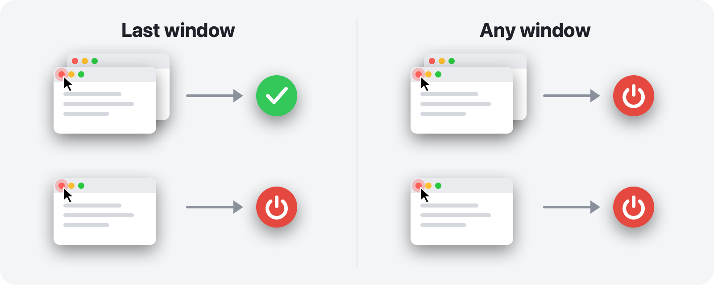

<p align="center">
  
</p>

<h1 align="center">RedQuit</h1>

<p align="center">
  <b>Close the window, quit the app.</b><br>
  The red button on your Mac works the way it does on Windows.
</p>

<p align="center">
  <a href="https://github.com/Toys-D/RedQuit/releases/latest"></a>
  
  
  
  <a href="LICENSE"></a>
</p>

<p align="center">
  <a href="https://github.com/Toys-D/RedQuit/releases/latest"><b>Download RedQuit</b></a> · macOS 14 Sonoma or newer · Apple Silicon and Intel · free
</p>

<p align="center">
  <b>English</b> ·
  <a href="docs/README.ru.md">Русский</a> ·
  <a href="docs/README.uk.md">Українська</a> ·
  <a href="docs/README.es.md">Español</a> ·
  <a href="docs/README.pt-BR.md">Português</a> ·
  <a href="docs/README.fr.md">Français</a> ·
  <a href="docs/README.de.md">Deutsch</a> ·
  <a href="docs/README.it.md">Italiano</a> ·
  <a href="docs/README.pl.md">Polski</a> ·
  <a href="docs/README.tr.md">Türkçe</a> ·
  <a href="docs/README.ja.md">日本語</a> ·
  <a href="docs/README.ko.md">한국어</a> ·
  <a href="docs/README.zh-Hans.md">简体中文</a> ·
  <a href="docs/README.zh-Hant.md">繁體中文</a> ·
  <a href="docs/README.ar.md">العربية</a> ·
  <a href="docs/README.hi.md">हिन्दी</a>
</p>


## Why

On a Mac, the red button only closes a window. The app keeps running: it stays in the Dock, holds on to memory and waits until you quit it with ⌘Q. If you came from Windows, or you simply expect the red button to mean "I'm done with this app", RedQuit is for you.

RedQuit sits in the menu bar and watches for one thing: a click on the red close button. When that click closes the app's last window, RedQuit quits the app.

## What it does

- **Only the red button.** ⌘W and File ▸ Close work as before. RedQuit reacts only to a mouse click on the red button.
- **Waits for the window to really close.** If the app asks "Save changes?" and you press Cancel, nothing happens.
- **Quits the normal way, like ⌘Q.** Apps still ask about unsaved documents. RedQuit never force-quits anything.
- **Knows where your windows are.** Minimized windows, windows on other desktops and full-screen windows count as open.
- **Leaves Finder and the system alone.** Add your own exceptions in one click.
- **Stays out of the way.** No Dock icon, just a small sign in the menu bar.
- **Speaks your language.** 16 languages, following your Mac's settings.
- **Private.** RedQuit only reads information about windows. It never clicks anything for you, never blocks or changes your clicks, makes no network connections and collects nothing.

## Two modes



| | **Last window** (default) | **Any window** |
|---|---|---|
| Red button on one of several windows | the app keeps running | the app quits |
| Red button on the last window | the app quits | the app quits |
| Good for | everyday use | apps you always use with one window |

Switch modes in the menu bar: RedQuit ▸ Mode.

## Screenshots

<picture>
  <source media="(prefers-color-scheme: dark)" srcset=".github/screenshots/settings-dark.png">
  
</picture>

| | |
|:---:|:---:|
|  |  |
| **The menu:** pause, mode, settings | **First launch:** one switch to turn on |

## Install

1. Download `RedQuit-1.0.1.dmg` from the [releases page](https://github.com/Toys-D/RedQuit/releases/latest) and drag **RedQuit** into **Applications**.
2. Open RedQuit. It has no paid Apple certificate, so the first time macOS refuses to open it. Go to **System Settings ▸ Privacy & Security**, scroll down and click **Open Anyway**.
3. RedQuit asks for Accessibility access. Click **Open System Settings** and turn on the switch next to RedQuit in **Privacy & Security ▸ Accessibility**. RedQuit starts working right away, no restart needed.
4. Optional: in RedQuit's settings, turn on **Open at login**.

**Updating.** Quit RedQuit from its menu and replace the app in Applications. macOS treats each new version as a new app, so the Accessibility switch stops working after an update: select RedQuit in the list, remove it with the **−** button and turn it on again.

## Languages

English, Русский, Українська, Español, Português (Brasil), Français, Deutsch, Italiano, Polski, Türkçe, 日本語, 한국어, 简体中文, 繁體中文, العربية, हिन्दी.

RedQuit follows your Mac's language. To choose another language for RedQuit only, go to **System Settings ▸ General ▸ Language & Region ▸ Applications**. The translations were made with care, but not all of them by native speakers: if something reads oddly, please [open an issue](https://github.com/Toys-D/RedQuit/issues).

## How it works

1. A global mouse monitor receives copies of your clicks. It cannot delay, block or change them.
2. On a click, RedQuit asks macOS's Accessibility API what is under the pointer. It acts only if that is a window's close button (`AXCloseButton`).
3. If you release the mouse button away from the red button, the close was cancelled and RedQuit does nothing.
4. RedQuit waits until the window is really gone. If the app shows "Save changes?", it waits for your answer.
5. In **Last window** mode it counts the app's remaining windows: regular and minimized ones through Accessibility, and windows on other desktops and in full screen through the window server.
6. If nothing is left (or in **Any window** mode), RedQuit asks the app to quit, exactly like ⌘Q.

Whenever RedQuit is not sure, it leaves the app running. Every decision is written to the system log: open **Console** and search for `subsystem:com.pixmaplabs.RedQuit`.

## Build from source

Requires Xcode 16 or newer (Swift 6) on macOS 14 or newer.

```bash
./Scripts/build.sh     # builds build/RedQuit.app
swift test             # unit tests
./Scripts/release.sh   # universal build and dist/RedQuit-<version>.dmg
```

`build.sh` signs the app with your Apple Development certificate if you have one, so the Accessibility permission survives rebuilds. Without one, run `ADHOC=1 ./Scripts/build.sh`.

The license allows building RedQuit for your own use, but not changing it or sharing changed builds.

## Support the project

RedQuit is free. If it saves you a few clicks every day and you would like to say thanks, you can support its development.

**[Support via PayPal](https://www.paypal.com/cgi-bin/webscr?cmd=_xclick&business=pixmap1981%40gmail.com&item_name=RedQuit&currency_code=USD)** · Support is voluntary; nothing in the app depends on it.

## Get in touch

Bugs, questions, ideas: **[pixmap1981@gmail.com](mailto:pixmap1981@gmail.com?subject=RedQuit)**, or open an [issue](https://github.com/Toys-D/RedQuit/issues).

## License

RedQuit is freeware. You may use it free of charge, at home or at work, and share unmodified copies. You may not change it, publish changed versions, or sell it. The full terms are in [LICENSE](LICENSE).

---

<p align="center">
  <br>
  <sub>Made by Pixmap Labs</sub>
</p>
