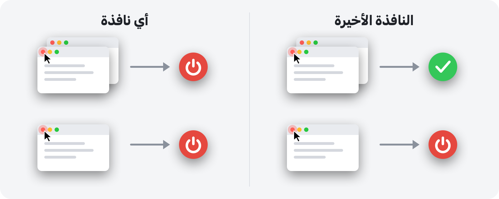

<p align="center">
  
</p>

<h1 align="center">RedQuit</h1>

<p align="center" dir="rtl">
  <b>أغلق النافذة، وأنهِ التطبيق.</b><br>
  يعمل الزر الأحمر على Mac كما يعمل في Windows.
</p>

<p align="center">
  <a href="https://github.com/Toys-D/RedQuit/releases/latest"></a>
  
  
  
  <a href="../LICENSE"></a>
</p>

<p align="center" dir="rtl">
  <a href="https://github.com/Toys-D/RedQuit/releases/latest"><b>تنزيل RedQuit</b></a> · macOS 14 Sonoma أو أحدث · Apple Silicon وIntel · مجاني
</p>

<p align="center">
  <a href="../README.md">English</a> ·
  <a href="README.ru.md">Русский</a> ·
  <a href="README.uk.md">Українська</a> ·
  <a href="README.es.md">Español</a> ·
  <a href="README.pt-BR.md">Português</a> ·
  <a href="README.fr.md">Français</a> ·
  <a href="README.de.md">Deutsch</a> ·
  <a href="README.it.md">Italiano</a> ·
  <a href="README.pl.md">Polski</a> ·
  <a href="README.tr.md">Türkçe</a> ·
  <a href="README.ja.md">日本語</a> ·
  <a href="README.ko.md">한국어</a> ·
  <a href="README.zh-Hans.md">简体中文</a> ·
  <a href="README.zh-Hant.md">繁體中文</a> ·
  <b>العربية</b> ·
  <a href="README.hi.md">हिन्दी</a>
</p>

<div dir="rtl">


## لماذا

على Mac، يكتفي الزر الأحمر بإغلاق النافذة. أما التطبيق فيبقى قيد التشغيل: يظل في شريط الأيقونات (Dock)، ويشغل الذاكرة، وينتظر حتى تُنهيه باستخدام ⌘Q. إذا كنت قادمًا من Windows، أو كنت ببساطة تتوقع أن يعني الزر الأحمر «انتهيت من هذا التطبيق»، فإن RedQuit مصمَّم لك.

يستقر RedQuit في شريط القوائم ويراقب شيئًا واحدًا فقط: النقر على زر الإغلاق الأحمر. وعندما يؤدي هذا النقر إلى إغلاق آخر نافذة للتطبيق، يُنهي RedQuit التطبيق.

## ما الذي يفعله

- **الزر الأحمر فقط.** يعمل ⌘W و«ملف ◂ إغلاق» كما كانا من قبل. لا يستجيب RedQuit إلا للنقر بالماوس على الزر الأحمر.
- **ينتظر حتى تُغلق النافذة فعلًا.** إذا سأل التطبيق «حفظ التغييرات؟» وضغطت على «إلغاء»، فلن يحدث شيء.
- **يُنهي التطبيق بالطريقة المعتادة، مثل ⌘Q.** تظل التطبيقات تسأل عن المستندات غير المحفوظة. ولا يفرض RedQuit إنهاء أي شيء أبدًا.
- **يعرف أين نوافذك.** النوافذ المصغّرة، والنوافذ على أسطح المكتب الأخرى، والنوافذ في وضع ملء الشاشة تُعدّ كلها مفتوحة.
- **لا يقترب من Finder ولا من النظام.** أضف استثناءاتك الخاصة بنقرة واحدة.
- **لا يزعجك.** لا أيقونة له في شريط الأيقونات، بل مجرد علامة صغيرة في شريط القوائم.
- **يتحدث لغتك.** 16 لغة، وفقًا لإعدادات Mac لديك.
- **يحترم خصوصيتك.** يقرأ RedQuit معلومات النوافذ فقط. لا ينقر على أي شيء نيابةً عنك أبدًا، ولا يحظر نقراتك أو يغيّرها، ولا يتصل بالشبكة، ولا يجمع أي بيانات.

## وضعان



| | **النافذة الأخيرة** (افتراضي) | **أي نافذة** |
|---|---|---|
| الزر الأحمر على نافذة من بين عدة نوافذ | يبقى التطبيق قيد التشغيل | يتم إنهاء التطبيق |
| الزر الأحمر على النافذة الأخيرة | يتم إنهاء التطبيق | يتم إنهاء التطبيق |
| مناسب لـ | الاستخدام اليومي | التطبيقات التي تستخدمها دائمًا بنافذة واحدة |

لتبديل الوضع، استخدم شريط القوائم: RedQuit ◂ الوضع.

## لقطات الشاشة

<picture>
  <source media="(prefers-color-scheme: dark)" srcset="../.github/screenshots/settings-dark.png">
  
</picture>

| | |
|:---:|:---:|
|  |  |
| **القائمة:** الإيقاف المؤقت، والوضع، والإعدادات | **التشغيل الأول:** مفتاح واحد فقط لتشغيله |

## التثبيت

1. نزّل `RedQuit-1.0.0.dmg` من [صفحة الإصدارات](https://github.com/Toys-D/RedQuit/releases/latest) واسحب **RedQuit** إلى **التطبيقات**.
2. افتح RedQuit. لا يملك RedQuit شهادة Apple مدفوعة، لذا يرفض macOS فتحه في المرة الأولى. انتقل إلى **إعدادات النظام ◂ الخصوصية والأمن**، ومرّر إلى الأسفل، ثم انقر على **فتح على أية حال**.
3. يطلب RedQuit إذن تسهيلات الاستخدام. انقر على **فتح إعدادات النظام** وشغّل المفتاح بجوار RedQuit في **الخصوصية والأمن ◂ تسهيلات الاستخدام**. يبدأ RedQuit العمل فورًا دون الحاجة إلى إعادة التشغيل.
4. اختياري: في إعدادات RedQuit، شغّل **فتح عند الدخول**.

**التحديث.** أنهِ RedQuit من قائمته واستبدل التطبيق في مجلد التطبيقات. يتعامل macOS مع كل إصدار جديد على أنه تطبيق جديد، لذا يتوقف مفتاح تسهيلات الاستخدام عن العمل بعد التحديث: حدّد RedQuit في القائمة، وأزِله بالزر **−**، ثم شغّله مرة أخرى.

## اللغات

English, Русский, Українська, Español, Português (Brasil), Français, Deutsch, Italiano, Polski, Türkçe, 日本語, 한국어, 简体中文, 繁體中文, العربية, हिन्दी.

يتبع RedQuit لغة Mac لديك. لاختيار لغة أخرى لـ RedQuit وحده، انتقل إلى **إعدادات النظام ◂ عام ◂ اللغة والمنطقة ◂ التطبيقات**. أُنجزت الترجمات بعناية، لكن ليست جميعها من إعداد متحدثين أصليين: إذا بدت لك عبارة غريبة، فيُرجى [فتح issue](https://github.com/Toys-D/RedQuit/issues).

## كيف يعمل

1. يتلقى مراقب عام للماوس نسخًا من نقراتك، ولا يمكنه تأخيرها أو حظرها أو تغييرها.
2. عند النقر، يسأل RedQuit واجهة برمجة تسهيلات الاستخدام في macOS عمّا يوجد تحت المؤشر. ولا يتصرف إلا إذا كان ذلك زر إغلاق نافذة (`AXCloseButton`).
3. إذا حرّرت زر الماوس بعيدًا عن الزر الأحمر، فهذا يعني أن الإغلاق أُلغي، ولا يفعل RedQuit شيئًا.
4. ينتظر RedQuit حتى تختفي النافذة فعلًا. وإذا عرض التطبيق «حفظ التغييرات؟»، فإنه ينتظر إجابتك.
5. في وضع **النافذة الأخيرة**، يعدّ النوافذ المتبقية للتطبيق: النوافذ العادية والمصغّرة عبر تسهيلات الاستخدام، والنوافذ على أسطح المكتب الأخرى وفي وضع ملء الشاشة عبر خادم النوافذ.
6. إذا لم يتبقَّ شيء (أو في وضع **أي نافذة**)، يطلب RedQuit من التطبيق إنهاء نفسه، تمامًا مثل ⌘Q.

كلما لم يكن RedQuit متأكدًا، يترك التطبيق قيد التشغيل. ويُسجَّل كل قرار في سجل النظام: افتح تطبيق **السِّجل** (Console) وابحث عن `subsystem:com.toysforminds.RedQuit`.

## البناء من المصدر

يتطلب Xcode 15 أو أحدث (Swift 6) على macOS 14 أو أحدث.

<div dir="ltr">

```bash
./Scripts/build.sh     # builds build/RedQuit.app
swift test             # unit tests
./Scripts/release.sh   # universal build and dist/RedQuit-<version>.dmg
```

</div>

يوقّع `build.sh` التطبيق بشهادة Apple Development الخاصة بك إن وُجدت، كي يبقى إذن تسهيلات الاستخدام قائمًا بعد إعادة البناء. وإن لم تكن لديك شهادة، فشغّل `ADHOC=1 ./Scripts/build.sh`.

يسمح الترخيص ببناء RedQuit لاستخدامك الشخصي، لكنه لا يسمح بتعديله أو بمشاركة نسخ معدّلة منه.

## ادعم المشروع

RedQuit مجاني. إذا كان يوفّر عليك بضع نقرات كل يوم وتودّ أن تقول شكرًا، فيمكنك دعم تطويره.

**[الدعم عبر PayPal](https://www.paypal.com/cgi-bin/webscr?cmd=_xclick&business=pixmap1981%40gmail.com&item_name=RedQuit&currency_code=USD)** · الدعم اختياري؛ لا يتوقف عليه أي شيء في التطبيق.

## تواصل معنا

الأخطاء والأسئلة والأفكار: **[pixmap1981@gmail.com](mailto:pixmap1981@gmail.com?subject=RedQuit)**، أو افتح [issue](https://github.com/Toys-D/RedQuit/issues).

## الترخيص

RedQuit برنامج مجاني (freeware). يمكنك استخدامه مجانًا في المنزل أو في العمل، ومشاركة نسخ غير معدّلة منه. ولا يجوز لك تعديله أو نشر نسخ معدّلة منه أو بيعه. الشروط الكاملة موجودة في [LICENSE](../LICENSE). النص الإنجليزي لملف LICENSE هو النسخة الملزمة، وهذا الملخص مقدَّم للتيسير فقط.

---

<p align="center">
  <br>
  <sub>من صنع Toys for Minds</sub>
</p>

</div>
