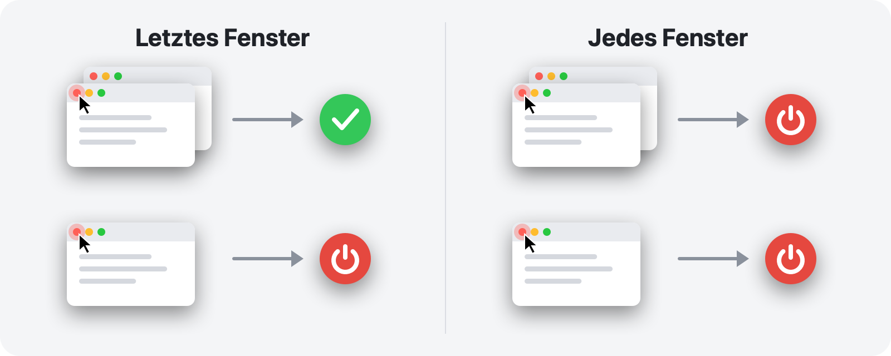

<p align="center">
  
</p>

<h1 align="center">RedQuit</h1>

<p align="center">
  <b>Fenster schließen, App beenden.</b><br>
  Die rote Taste auf Ihrem Mac funktioniert so wie unter Windows.
</p>

<p align="center">
  <a href="https://github.com/Toys-D/RedQuit/releases/latest"></a>
  
  
  
  <a href="../LICENSE"></a>
</p>

<p align="center">
  <a href="https://github.com/Toys-D/RedQuit/releases/latest"><b>RedQuit herunterladen</b></a> · macOS 14 Sonoma oder neuer · Apple Silicon und Intel · kostenlos
</p>

<p align="center">
  <a href="../README.md">English</a> ·
  <a href="README.ru.md">Русский</a> ·
  <a href="README.uk.md">Українська</a> ·
  <a href="README.es.md">Español</a> ·
  <a href="README.pt-BR.md">Português</a> ·
  <a href="README.fr.md">Français</a> ·
  <b>Deutsch</b> ·
  <a href="README.it.md">Italiano</a> ·
  <a href="README.pl.md">Polski</a> ·
  <a href="README.tr.md">Türkçe</a> ·
  <a href="README.ja.md">日本語</a> ·
  <a href="README.ko.md">한국어</a> ·
  <a href="README.zh-Hans.md">简体中文</a> ·
  <a href="README.zh-Hant.md">繁體中文</a> ·
  <a href="README.ar.md">العربية</a> ·
  <a href="README.hi.md">हिन्दी</a>
</p>


## Warum

Auf dem Mac schließt die rote Taste nur ein Fenster. Die App läuft weiter: Sie bleibt im Dock, belegt Arbeitsspeicher und wartet, bis Sie sie mit ⌘Q beenden. Wenn Sie von Windows kommen oder einfach erwarten, dass die rote Taste „Ich bin fertig mit dieser App“ bedeutet, ist RedQuit genau das Richtige für Sie.

RedQuit sitzt in der Menüleiste und achtet auf genau eine Sache: einen Klick auf die rote Schließen-Taste. Wenn dieser Klick das letzte Fenster der App schließt, beendet RedQuit die App.

## Was es tut

- **Nur die rote Taste.** ⌘W und „Ablage ▸ Schließen“ funktionieren wie bisher. RedQuit reagiert nur auf einen Mausklick auf die rote Taste.
- **Wartet, bis das Fenster wirklich geschlossen ist.** Wenn die App „Änderungen sichern?“ fragt und Sie auf „Abbrechen“ klicken, passiert nichts.
- **Beendet ganz normal, wie ⌘Q.** Apps fragen weiterhin nach ungesicherten Dokumenten. RedQuit erzwingt niemals das Beenden einer App.
- **Weiß, wo Ihre Fenster sind.** Im Dock abgelegte Fenster, Fenster auf anderen Schreibtischen und Fenster im Vollbildmodus zählen als geöffnet.
- **Lässt den Finder und das System in Ruhe.** Eigene Ausnahmen fügen Sie mit einem Klick hinzu.
- **Hält sich im Hintergrund.** Kein Dock-Symbol, nur ein kleines Zeichen in der Menüleiste.
- **Spricht Ihre Sprache.** 16 Sprachen, passend zu den Einstellungen Ihres Mac.
- **Privat.** RedQuit liest nur Informationen über Fenster. Es klickt nie etwas für Sie an, blockiert oder verändert niemals Ihre Klicks, baut keine Netzwerkverbindungen auf und sammelt keine Daten.

## Zwei Modi



| | **Letztes Fenster** (Standard) | **Jedes Fenster** |
|---|---|---|
| Rote Taste an einem von mehreren Fenstern | die App läuft weiter | die App wird beendet |
| Rote Taste am letzten Fenster | die App wird beendet | die App wird beendet |
| Geeignet für | den Alltag | Apps, die Sie immer mit nur einem Fenster nutzen |

Den Modus wechseln Sie in der Menüleiste: RedQuit ▸ Modus.

## Bildschirmfotos

<picture>
  <source media="(prefers-color-scheme: dark)" srcset="../.github/screenshots/settings-dark.png">
  
</picture>

| | |
|:---:|:---:|
|  |  |
| **Das Menü:** Pause, Modus, Einstellungen | **Erster Start:** nur einen Schalter aktivieren |

## Installation

1. Laden Sie `RedQuit-1.0.0.dmg` von der [Release-Seite](https://github.com/Toys-D/RedQuit/releases/latest) herunter und ziehen Sie **RedQuit** in den Ordner **Programme**.
2. Öffnen Sie RedQuit. Da es kein kostenpflichtiges Apple-Zertifikat hat, verweigert macOS beim ersten Mal das Öffnen. Gehen Sie zu **Systemeinstellungen ▸ Datenschutz & Sicherheit**, scrollen Sie nach unten und klicken Sie auf **Dennoch öffnen**.
3. RedQuit bittet um Zugriff auf die Bedienungshilfen. Klicken Sie auf **Systemeinstellungen öffnen** und aktivieren Sie unter **Datenschutz & Sicherheit ▸ Bedienungshilfen** den Schalter neben RedQuit. RedQuit legt sofort los, ein Neustart ist nicht nötig.
4. Optional: Aktivieren Sie in den Einstellungen von RedQuit **Bei der Anmeldung öffnen**.

**Aktualisieren.** Beenden Sie RedQuit über sein Menü und ersetzen Sie die App im Ordner „Programme“. macOS behandelt jede neue Version als neue App, deshalb funktioniert der Bedienungshilfen-Schalter nach einem Update nicht mehr: Wählen Sie RedQuit in der Liste aus, entfernen Sie es mit der Taste **−** und aktivieren Sie es erneut.

## Sprachen

English, Русский, Українська, Español, Português (Brasil), Français, Deutsch, Italiano, Polski, Türkçe, 日本語, 한국어, 简体中文, 繁體中文, العربية, हिन्दी.

RedQuit verwendet die Sprache Ihres Mac. Um nur für RedQuit eine andere Sprache auszuwählen, gehen Sie zu **Systemeinstellungen ▸ Allgemein ▸ Sprache & Region ▸ Programme**. Die Übersetzungen wurden mit Sorgfalt erstellt, aber nicht alle von Muttersprachlern: Wenn etwas seltsam klingt, [eröffnen Sie bitte ein Issue](https://github.com/Toys-D/RedQuit/issues).

## So funktioniert es

1. Ein globaler Mausmonitor erhält Kopien Ihrer Klicks. Er kann sie weder verzögern noch blockieren oder verändern.
2. Bei einem Klick fragt RedQuit über die Bedienungshilfen-API von macOS ab, was sich unter dem Zeiger befindet. Es reagiert nur, wenn das die Schließen-Taste eines Fensters ist (`AXCloseButton`).
3. Lassen Sie die Maustaste außerhalb der roten Taste los, wurde das Schließen abgebrochen und RedQuit tut nichts.
4. RedQuit wartet, bis das Fenster wirklich verschwunden ist. Zeigt die App „Änderungen sichern?“ an, wartet es auf Ihre Antwort.
5. Im Modus **Letztes Fenster** zählt es die verbleibenden Fenster der App: normale und im Dock abgelegte über die Bedienungshilfen, Fenster auf anderen Schreibtischen und im Vollbildmodus über den Window Server.
6. Ist kein Fenster mehr übrig (oder im Modus **Jedes Fenster**), fordert RedQuit die App zum Beenden auf, genau wie ⌘Q.

Wann immer RedQuit sich nicht sicher ist, lässt es die App weiterlaufen. Jede Entscheidung wird im Systemprotokoll festgehalten: Öffnen Sie die **Konsole** und suchen Sie nach `subsystem:com.toysforminds.RedQuit`.

## Aus dem Quellcode erstellen

Erfordert Xcode 16 oder neuer (Swift 6) unter macOS 14 oder neuer.

```bash
./Scripts/build.sh     # builds build/RedQuit.app
swift test             # unit tests
./Scripts/release.sh   # universal build and dist/RedQuit-<version>.dmg
```

`build.sh` signiert die App mit Ihrem Apple-Development-Zertifikat, falls Sie eines haben, damit die Bedienungshilfen-Berechtigung auch nach einem Neuerstellen erhalten bleibt. Ohne Zertifikat führen Sie `ADHOC=1 ./Scripts/build.sh` aus.

Die Lizenz erlaubt es, RedQuit für den eigenen Gebrauch zu erstellen, aber nicht, es zu verändern oder veränderte Builds weiterzugeben.

## Das Projekt unterstützen

RedQuit ist kostenlos. Wenn es Ihnen jeden Tag ein paar Klicks erspart und Sie sich bedanken möchten, können Sie die Entwicklung unterstützen.

**[Über PayPal unterstützen](https://www.paypal.com/cgi-bin/webscr?cmd=_xclick&business=pixmap1981%40gmail.com&item_name=RedQuit&currency_code=USD)** · Die Unterstützung ist freiwillig; nichts in der App hängt davon ab.

## Kontakt

Fehler, Fragen, Ideen: **[pixmap1981@gmail.com](mailto:pixmap1981@gmail.com?subject=RedQuit)** oder eröffnen Sie ein [Issue](https://github.com/Toys-D/RedQuit/issues).

## Lizenz

RedQuit ist Freeware. Sie dürfen es kostenlos nutzen, zu Hause oder bei der Arbeit, und unveränderte Kopien weitergeben. Sie dürfen es nicht verändern, keine veränderten Versionen veröffentlichen und es nicht verkaufen. Die vollständigen Bedingungen finden Sie in [LICENSE](../LICENSE). Rechtlich verbindlich ist der englische Text in LICENSE; diese Zusammenfassung dient nur der Übersicht.

---

<p align="center">
  <br>
  <sub>Entwickelt von Toys for Minds</sub>
</p>
