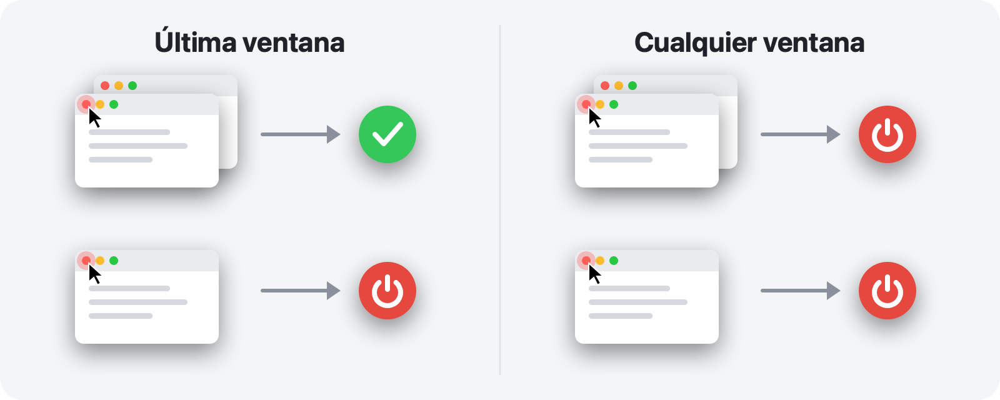

<p align="center">
  
</p>

<h1 align="center">RedQuit</h1>

<p align="center">
  <b>Cierra la ventana, sal de la app.</b><br>
  El botón rojo de tu Mac funciona como en Windows.
</p>

<p align="center">
  <a href="https://github.com/Toys-D/RedQuit/releases/latest"></a>
  
  
  
  <a href="../LICENSE"></a>
</p>

<p align="center">
  <a href="https://github.com/Toys-D/RedQuit/releases/latest"><b>Descargar RedQuit</b></a> · macOS 14 Sonoma o posterior · Apple Silicon e Intel · gratis
</p>

<p align="center">
  <a href="../README.md">English</a> ·
  <a href="README.ru.md">Русский</a> ·
  <a href="README.uk.md">Українська</a> ·
  <b>Español</b> ·
  <a href="README.pt-BR.md">Português</a> ·
  <a href="README.fr.md">Français</a> ·
  <a href="README.de.md">Deutsch</a> ·
  <a href="README.it.md">Italiano</a> ·
  <a href="README.pl.md">Polski</a> ·
  <a href="README.tr.md">Türkçe</a> ·
  <a href="README.ja.md">日本語</a> ·
  <a href="README.ko.md">한국어</a> ·
  <a href="README.zh-Hans.md">简体中文</a> ·
  <a href="README.zh-Hant.md">繁體中文</a> ·
  <a href="README.ar.md">العربية</a> ·
  <a href="README.hi.md">हिन्दी</a>
</p>


## Por qué

En un Mac, el botón rojo solo cierra la ventana. La app sigue abierta: permanece en el Dock, ocupa memoria y espera a que salgas de ella con ⌘Q. Si vienes de Windows, o simplemente esperas que el botón rojo signifique «he terminado con esta app», RedQuit es para ti.

RedQuit se queda en la barra de menús y vigila una sola cosa: un clic en el botón rojo de cerrar. Cuando ese clic cierra la última ventana de la app, RedQuit cierra la app por completo.

## Qué hace

- **Solo el botón rojo.** ⌘W y Archivo ▸ Cerrar funcionan como siempre. RedQuit solo reacciona a un clic del ratón en el botón rojo.
- **Espera a que la ventana se cierre de verdad.** Si la app pregunta «¿Guardar cambios?» y pulsas Cancelar, no pasa nada.
- **Cierra la app de la forma normal, como ⌘Q.** Las apps siguen preguntando por los documentos sin guardar. RedQuit nunca fuerza la salida de nada.
- **Sabe dónde están tus ventanas.** Las ventanas minimizadas, las de otros escritorios y las que están a pantalla completa cuentan como abiertas.
- **No toca el Finder ni el sistema.** Añade tus propias excepciones con un clic.
- **No molesta.** Sin icono en el Dock, solo un pequeño símbolo en la barra de menús.
- **Habla tu idioma.** 16 idiomas, según los ajustes de tu Mac.
- **Privado.** RedQuit solo lee información sobre las ventanas. Nunca hace clic en nada por ti, nunca bloquea ni modifica tus clics, no se conecta a la red y no recopila nada.

## Dos modos



| | **Última ventana** (predeterminado) | **Cualquier ventana** |
|---|---|---|
| Botón rojo en una de varias ventanas | la app sigue abierta | la app se cierra |
| Botón rojo en la última ventana | la app se cierra | la app se cierra |
| Ideal para | el uso diario | apps que siempre usas con una sola ventana |

Cambia de modo desde la barra de menús: RedQuit ▸ Modo.

## Capturas de pantalla

<picture>
  <source media="(prefers-color-scheme: dark)" srcset="../.github/screenshots/settings-dark.png">
  
</picture>

| | |
|:---:|:---:|
|  |  |
| **El menú:** pausa, modo, ajustes | **Primer arranque:** un solo interruptor que activar |

## Instalación

1. Descarga `RedQuit-1.0.0.dmg` desde la [página de versiones](https://github.com/Toys-D/RedQuit/releases/latest) y arrastra **RedQuit** a **Aplicaciones**.
2. Abre RedQuit. No tiene un certificado de pago de Apple, así que la primera vez macOS se niega a abrirlo. Ve a **Ajustes del Sistema ▸ Privacidad y seguridad**, desplázate hacia abajo y haz clic en **Abrir igualmente**.
3. RedQuit solicita acceso a Accesibilidad. Haz clic en **Abrir Ajustes del Sistema** y activa el interruptor junto a RedQuit en **Privacidad y seguridad ▸ Accesibilidad**. RedQuit empieza a funcionar al instante, sin necesidad de reiniciar.
4. Opcional: en los ajustes de RedQuit, activa **Abrir al iniciar sesión**.

**Actualización.** Sal de RedQuit desde su menú y sustituye la app en Aplicaciones. macOS trata cada nueva versión como una app nueva, así que el interruptor de Accesibilidad deja de funcionar tras una actualización: selecciona RedQuit en la lista, elimínalo con el botón **−** y vuelve a activarlo.

## Idiomas

English, Русский, Українська, Español, Português (Brasil), Français, Deutsch, Italiano, Polski, Türkçe, 日本語, 한국어, 简体中文, 繁體中文, العربية, हिन्दी.

RedQuit usa el idioma de tu Mac. Para elegir otro idioma solo para RedQuit, ve a **Ajustes del Sistema ▸ General ▸ Idioma y región ▸ Aplicaciones**. Las traducciones se han hecho con cuidado, aunque no todas son obra de hablantes nativos: si algo suena raro, por favor, [abre un issue](https://github.com/Toys-D/RedQuit/issues).

## Cómo funciona

1. Un monitor global del ratón recibe copias de tus clics. No puede retrasarlos, bloquearlos ni modificarlos.
2. Con cada clic, RedQuit pregunta a la API de accesibilidad de macOS qué hay bajo el puntero. Solo actúa si se trata del botón de cerrar de una ventana (`AXCloseButton`).
3. Si sueltas el botón del ratón fuera del botón rojo, el cierre se ha cancelado y RedQuit no hace nada.
4. RedQuit espera hasta que la ventana desaparece de verdad. Si la app muestra «¿Guardar cambios?», espera a tu respuesta.
5. En el modo **Última ventana**, cuenta las ventanas que le quedan a la app: las normales y las minimizadas a través de la API de accesibilidad, y las de otros escritorios y a pantalla completa a través del servidor de ventanas.
6. Si no queda ninguna (o en el modo **Cualquier ventana**), RedQuit le pide a la app que se cierre, exactamente igual que ⌘Q.

Siempre que RedQuit no está seguro, deja la app abierta. Cada decisión se escribe en el registro del sistema: abre **Consola** y busca `subsystem:com.toysforminds.RedQuit`.

## Compilar desde el código fuente

Requiere Xcode 16 o posterior (Swift 6) en macOS 14 o posterior.

```bash
./Scripts/build.sh     # builds build/RedQuit.app
swift test             # unit tests
./Scripts/release.sh   # universal build and dist/RedQuit-<version>.dmg
```

`build.sh` firma la app con tu certificado Apple Development si tienes uno, de modo que el permiso de Accesibilidad se conserva entre compilaciones. Si no lo tienes, ejecuta `ADHOC=1 ./Scripts/build.sh`.

La licencia permite compilar RedQuit para tu propio uso, pero no modificarlo ni compartir compilaciones modificadas.

## Apoya el proyecto

RedQuit es gratuito. Si te ahorra unos cuantos clics cada día y te gustaría darnos las gracias, puedes apoyar su desarrollo.

**[Apoyar mediante PayPal](https://www.paypal.com/cgi-bin/webscr?cmd=_xclick&business=pixmap1981%40gmail.com&item_name=RedQuit&currency_code=USD)** · El apoyo es voluntario; nada en la app depende de él.

## Contacto

Errores, preguntas, ideas: **[pixmap1981@gmail.com](mailto:pixmap1981@gmail.com?subject=RedQuit)**, o abre un [issue](https://github.com/Toys-D/RedQuit/issues).

## Licencia

RedQuit es freeware. Puedes usarlo gratis, en casa o en el trabajo, y compartir copias sin modificar. No puedes modificarlo, publicar versiones modificadas ni venderlo. Los términos completos están en [LICENSE](../LICENSE). La versión vinculante es el texto en inglés de LICENSE; este resumen se ofrece solo por comodidad.

---

<p align="center">
  <br>
  <sub>Hecho por Toys for Minds</sub>
</p>
