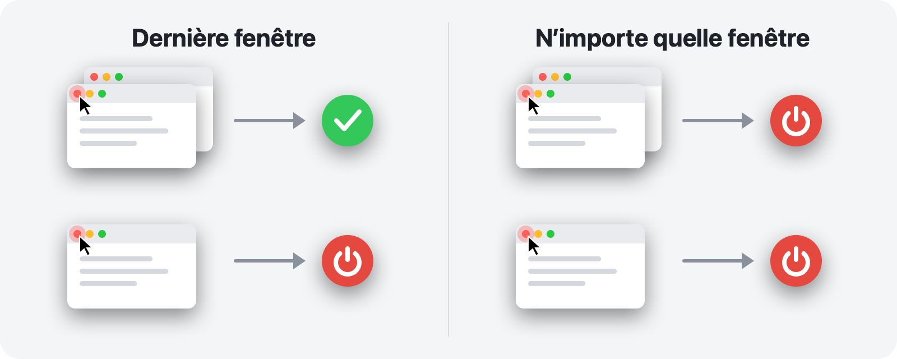

<p align="center">
  
</p>

<h1 align="center">RedQuit</h1>

<p align="center">
  <b>Fermez la fenêtre, quittez l’app.</b><br>
  Le bouton rouge de votre Mac fonctionne comme sous Windows.
</p>

<p align="center">
  <a href="https://github.com/Toys-D/RedQuit/releases/latest"></a>
  
  
  
  <a href="../LICENSE"></a>
</p>

<p align="center">
  <a href="https://github.com/Toys-D/RedQuit/releases/latest"><b>Télécharger RedQuit</b></a> · macOS 14 Sonoma ou ultérieur · Apple Silicon et Intel · gratuit
</p>

<p align="center">
  <a href="../README.md">English</a> ·
  <a href="README.ru.md">Русский</a> ·
  <a href="README.uk.md">Українська</a> ·
  <a href="README.es.md">Español</a> ·
  <a href="README.pt-BR.md">Português</a> ·
  <b>Français</b> ·
  <a href="README.de.md">Deutsch</a> ·
  <a href="README.it.md">Italiano</a> ·
  <a href="README.pl.md">Polski</a> ·
  <a href="README.tr.md">Türkçe</a> ·
  <a href="README.ja.md">日本語</a> ·
  <a href="README.ko.md">한국어</a> ·
  <a href="README.zh-Hans.md">简体中文</a> ·
  <a href="README.zh-Hant.md">繁體中文</a> ·
  <a href="README.ar.md">العربية</a> ·
  <a href="README.hi.md">हिन्दी</a>
</p>


## Pourquoi

Sur Mac, le bouton rouge ne fait que fermer une fenêtre. L’app continue de tourner : elle reste dans le Dock, occupe de la mémoire et attend que vous la quittiez avec ⌘Q. Si vous venez de Windows, ou si vous attendez simplement du bouton rouge qu’il signifie « j’en ai fini avec cette app », RedQuit est fait pour vous.

RedQuit se loge dans la barre des menus et ne surveille qu’une chose : un clic sur le bouton rouge de fermeture. Lorsque ce clic ferme la dernière fenêtre de l’app, RedQuit quitte l’app.

## Ce qu’il fait

- **Seulement le bouton rouge.** ⌘W et Fichier ▸ Fermer fonctionnent comme avant. RedQuit ne réagit qu’à un clic de souris sur le bouton rouge.
- **Attend que la fenêtre soit vraiment fermée.** Si l’app demande « Enregistrer les modifications ? » et que vous cliquez sur Annuler, il ne se passe rien.
- **Quitte normalement, comme ⌘Q.** Les apps vous interrogent toujours sur les documents non enregistrés. RedQuit ne force jamais une app à quitter.
- **Sait où se trouvent vos fenêtres.** Les fenêtres placées dans le Dock, celles d’autres bureaux et celles en plein écran comptent comme ouvertes.
- **Laisse tranquilles le Finder et le système.** Ajoutez vos propres exceptions en un clic.
- **Se fait discret.** Pas d’icône dans le Dock, juste un petit symbole dans la barre des menus.
- **Parle votre langue.** 16 langues, selon les réglages de votre Mac.
- **Respecte votre vie privée.** RedQuit ne fait que lire des informations sur les fenêtres. Il ne clique jamais à votre place, ne bloque ni ne modifie jamais vos clics, n’établit aucune connexion réseau et ne collecte rien.

## Deux modes



| | **Dernière fenêtre** (par défaut) | **N’importe quelle fenêtre** |
|---|---|---|
| Bouton rouge sur l’une de plusieurs fenêtres | l’app continue de tourner | l’app quitte |
| Bouton rouge sur la dernière fenêtre | l’app quitte | l’app quitte |
| Idéal pour | l’usage quotidien | les apps que vous utilisez toujours avec une seule fenêtre |

Changez de mode dans la barre des menus : RedQuit ▸ Mode.

## Captures d’écran

<picture>
  <source media="(prefers-color-scheme: dark)" srcset="../.github/screenshots/settings-dark.png">
  
</picture>

| | |
|:---:|:---:|
|  |  |
| **Le menu :** pause, mode, réglages | **Premier lancement :** une seule option à activer |

## Installation

1. Téléchargez `RedQuit-1.0.0.dmg` depuis la [page des versions](https://github.com/Toys-D/RedQuit/releases/latest) et faites glisser **RedQuit** dans **Applications**.
2. Ouvrez RedQuit. Comme il ne dispose pas d’un certificat Apple payant, macOS refuse de l’ouvrir la première fois. Allez dans **Réglages Système ▸ Confidentialité et sécurité**, faites défiler vers le bas et cliquez sur **Ouvrir quand même**.
3. RedQuit demande l’accès Accessibilité. Cliquez sur **Ouvrir Réglages Système** et activez l’option à côté de RedQuit dans **Confidentialité et sécurité ▸ Accessibilité**. RedQuit fonctionne aussitôt, sans redémarrage.
4. Facultatif : dans les réglages de RedQuit, activez **Ouvrir avec la session**.

**Mise à jour.** Quittez RedQuit depuis son menu et remplacez l’app dans Applications. macOS considère chaque nouvelle version comme une nouvelle app ; l’option Accessibilité cesse donc de fonctionner après une mise à jour : sélectionnez RedQuit dans la liste, supprimez-le avec le bouton **−**, puis activez-le à nouveau.

## Langues

English, Русский, Українська, Español, Português (Brasil), Français, Deutsch, Italiano, Polski, Türkçe, 日本語, 한국어, 简体中文, 繁體中文, العربية, हिन्दी.

RedQuit suit la langue de votre Mac. Pour choisir une autre langue pour RedQuit uniquement, allez dans **Réglages Système ▸ Général ▸ Langue et région ▸ Applications**. Les traductions ont été faites avec soin, mais pas toutes par des locuteurs natifs : si une formulation vous semble étrange, merci d’[ouvrir une issue](https://github.com/Toys-D/RedQuit/issues).

## Comment ça marche

1. Un moniteur global de la souris reçoit des copies de vos clics. Il ne peut ni les retarder, ni les bloquer, ni les modifier.
2. Lors d’un clic, RedQuit demande à l’API d’accessibilité de macOS ce qui se trouve sous le pointeur. Il n’agit que s’il s’agit du bouton de fermeture d’une fenêtre (`AXCloseButton`).
3. Si vous relâchez le bouton de la souris en dehors du bouton rouge, la fermeture est annulée et RedQuit ne fait rien.
4. RedQuit attend que la fenêtre ait réellement disparu. Si l’app affiche « Enregistrer les modifications ? », il attend votre réponse.
5. En mode **Dernière fenêtre**, il compte les fenêtres restantes de l’app : les fenêtres ordinaires et celles placées dans le Dock via l’accessibilité, celles d’autres bureaux et en plein écran via le serveur de fenêtres.
6. S’il ne reste plus rien (ou en mode **N’importe quelle fenêtre**), RedQuit demande à l’app de quitter, exactement comme ⌘Q.

Dès que RedQuit a un doute, il laisse l’app tourner. Chaque décision est consignée dans le journal système : ouvrez **Console** et recherchez `subsystem:com.toysforminds.RedQuit`.

## Compiler depuis les sources

Nécessite Xcode 15 ou ultérieur (Swift 6) sous macOS 14 ou ultérieur.

```bash
./Scripts/build.sh     # builds build/RedQuit.app
swift test             # unit tests
./Scripts/release.sh   # universal build and dist/RedQuit-<version>.dmg
```

`build.sh` signe l’app avec votre certificat Apple Development si vous en avez un, afin que l’autorisation Accessibilité soit conservée d’une compilation à l’autre. Sinon, lancez `ADHOC=1 ./Scripts/build.sh`.

La licence autorise à compiler RedQuit pour votre usage personnel, mais pas à le modifier ni à partager des versions modifiées.

## Soutenir le projet

RedQuit est gratuit. S’il vous épargne quelques clics chaque jour et que vous souhaitez dire merci, vous pouvez soutenir son développement.

**[Soutenir via PayPal](https://www.paypal.com/cgi-bin/webscr?cmd=_xclick&business=pixmap1981%40gmail.com&item_name=RedQuit&currency_code=USD)** · Le soutien est facultatif ; rien dans l’app n’en dépend.

## Contact

Bugs, questions, idées : **[pixmap1981@gmail.com](mailto:pixmap1981@gmail.com?subject=RedQuit)**, ou ouvrez une [issue](https://github.com/Toys-D/RedQuit/issues).

## Licence

RedQuit est un freeware. Vous pouvez l’utiliser gratuitement, chez vous ou au travail, et partager des copies non modifiées. Vous ne pouvez pas le modifier, en publier des versions modifiées ni le vendre. Les conditions complètes figurent dans [LICENSE](../LICENSE). Seul le texte anglais de LICENSE fait foi ; ce résumé est fourni à titre indicatif.

---

<p align="center">
  <br>
  <sub>Créé par Toys for Minds</sub>
</p>
