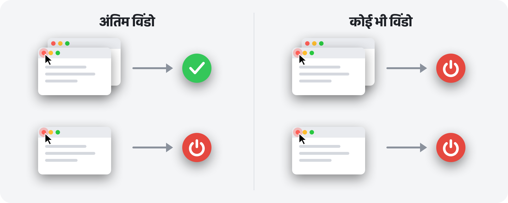

<p align="center">
  
</p>

<h1 align="center">RedQuit</h1>

<p align="center">
  <b>विंडो बंद करें, ऐप भी बंद।</b><br>
  आपके Mac का लाल बटन वैसे ही काम करता है जैसे Windows पर।
</p>

<p align="center">
  <a href="https://github.com/Toys-D/RedQuit/releases/latest"></a>
  
  
  
  <a href="../LICENSE"></a>
</p>

<p align="center">
  <a href="https://github.com/Toys-D/RedQuit/releases/latest"><b>RedQuit डाउनलोड करें</b></a> · macOS 14 Sonoma या नया · Apple सिलिकॉन और Intel · मुफ़्त
</p>

<p align="center">
  <a href="../README.md">English</a> ·
  <a href="README.ru.md">Русский</a> ·
  <a href="README.uk.md">Українська</a> ·
  <a href="README.es.md">Español</a> ·
  <a href="README.pt-BR.md">Português</a> ·
  <a href="README.fr.md">Français</a> ·
  <a href="README.de.md">Deutsch</a> ·
  <a href="README.it.md">Italiano</a> ·
  <a href="README.pl.md">Polski</a> ·
  <a href="README.tr.md">Türkçe</a> ·
  <a href="README.ja.md">日本語</a> ·
  <a href="README.ko.md">한국어</a> ·
  <a href="README.zh-Hans.md">简体中文</a> ·
  <a href="README.zh-Hant.md">繁體中文</a> ·
  <a href="README.ar.md">العربية</a> ·
  <b>हिन्दी</b>
</p>


## RedQuit क्यों

Mac पर लाल बटन सिर्फ़ विंडो बंद करता है। ऐप चलता रहता है: वह Dock में बना रहता है, मेमोरी घेरे रहता है और तब तक इंतज़ार करता है जब तक आप उसे ⌘Q से बंद न करें। अगर आप Windows से आए हैं, या बस यह चाहते हैं कि लाल बटन का मतलब हो “इस ऐप से मेरा काम हो गया”, तो RedQuit आपके लिए है।

RedQuit मेनू बार में रहता है और सिर्फ़ एक चीज़ पर नज़र रखता है: लाल “बंद करें” बटन पर क्लिक। जब उस क्लिक से ऐप की अंतिम विंडो बंद हो जाती है, तो RedQuit ऐप को बंद कर देता है।

## यह क्या करता है

- **सिर्फ़ लाल बटन।** ⌘W और फ़ाइल ▸ बंद करें पहले की तरह ही काम करते हैं। RedQuit सिर्फ़ लाल बटन पर माउस क्लिक होने पर प्रतिक्रिया देता है।
- **विंडो के सचमुच बंद होने का इंतज़ार करता है।** अगर ऐप पूछता है “बदलाव सहेजें?” और आप “रद्द करें” दबाते हैं, तो कुछ नहीं होता।
- **सामान्य तरीके से बंद करता है, ⌘Q की तरह।** बिना सहेजे दस्तावेज़ों के बारे में ऐप्स पहले की तरह पूछते हैं। RedQuit कभी किसी ऐप को ज़बरदस्ती बंद नहीं करता।
- **जानता है कि आपकी विंडो कहाँ हैं।** मिनिमाइज़ की गई विंडो, दूसरे डेस्कटॉप पर मौजूद विंडो और फ़ुल स्क्रीन विंडो को खुला माना जाता है।
- **Finder और सिस्टम को नहीं छूता।** अपने अपवाद एक क्लिक में जोड़ें।
- **रास्ते में नहीं आता।** कोई Dock आइकॉन नहीं, बस मेनू बार में एक छोटा-सा चिह्न।
- **आपकी भाषा बोलता है।** 16 भाषाएँ, आपके Mac की सेटिंग्ज़ के अनुसार।
- **निजता का ध्यान।** RedQuit केवल विंडो से जुड़ी जानकारी पढ़ता है। वह आपकी ओर से कभी कुछ क्लिक नहीं करता, आपके क्लिक को कभी रोकता या बदलता नहीं, कोई नेटवर्क कनेक्शन नहीं बनाता और कुछ भी इकट्ठा नहीं करता।

## दो मोड



| | **अंतिम विंडो** (डिफ़ॉल्ट) | **कोई भी विंडो** |
|---|---|---|
| कई विंडो में से एक पर लाल बटन | ऐप चलता रहता है | ऐप बंद हो जाता है |
| अंतिम विंडो पर लाल बटन | ऐप बंद हो जाता है | ऐप बंद हो जाता है |
| किसके लिए अच्छा | रोज़मर्रा का इस्तेमाल | ऐसे ऐप्स जिन्हें आप हमेशा एक ही विंडो में इस्तेमाल करते हैं |

मोड मेनू बार से बदलें: RedQuit ▸ मोड।

## स्क्रीनशॉट

<picture>
  <source media="(prefers-color-scheme: dark)" srcset="../.github/screenshots/settings-dark.png">
  
</picture>

| | |
|:---:|:---:|
|  |  |
| **मेनू:** रोकें, मोड, सेटिंग्ज़ | **पहली बार खोलने पर:** बस एक स्विच चालू करना है |

## इंस्टॉल करें

1. [रिलीज़ पेज](https://github.com/Toys-D/RedQuit/releases/latest) से `RedQuit-1.0.1.dmg` डाउनलोड करें और **RedQuit** को **ऐप्लिकेशन** फ़ोल्डर में ड्रैग करें।
2. RedQuit खोलें। इसके पास सशुल्क Apple सर्टिफ़िकेट नहीं है, इसलिए पहली बार macOS इसे खोलने से मना कर देता है। **सिस्टम सेटिंग्ज़ ▸ गोपनीयता और सुरक्षा** में जाएँ, नीचे स्क्रॉल करें और **फिर भी खोलें** पर क्लिक करें।
3. RedQuit ऐक्सेसिबिलिटी अनुमति माँगता है। **सिस्टम सेटिंग्ज़ खोलें** पर क्लिक करें और **गोपनीयता और सुरक्षा ▸ ऐक्सेसिबिलिटी** में RedQuit के आगे वाला स्विच चालू करें। RedQuit तुरंत काम करना शुरू कर देता है, रीस्टार्ट करने की ज़रूरत नहीं।
4. वैकल्पिक: RedQuit की सेटिंग्ज़ में **लॉगिन पर खोलें** चालू करें।

**अपडेट करना।** RedQuit को उसके मेनू से बंद करें और ऐप्लिकेशन फ़ोल्डर में ऐप को नए से बदल दें। macOS हर नए संस्करण को एक नया ऐप मानता है, इसलिए अपडेट के बाद ऐक्सेसिबिलिटी स्विच काम करना बंद कर देता है: सूची में RedQuit चुनें, **−** बटन से उसे हटाएँ और फिर से चालू करें।

## भाषाएँ

English, Русский, Українська, Español, Português (Brasil), Français, Deutsch, Italiano, Polski, Türkçe, 日本語, 한국어, 简体中文, 繁體中文, العربية, हिन्दी.

RedQuit आपके Mac की भाषा का पालन करता है। सिर्फ़ RedQuit के लिए कोई दूसरी भाषा चुनने के लिए **सिस्टम सेटिंग्ज़ ▸ सामान्य ▸ भाषा और क्षेत्र ▸ ऐप्लिकेशन** में जाएँ। अनुवाद ध्यान से किए गए हैं, लेकिन सभी मूल भाषियों ने नहीं किए: अगर कुछ अटपटा लगे, तो कृपया [एक issue खोलें](https://github.com/Toys-D/RedQuit/issues)।

## यह कैसे काम करता है

1. एक ग्लोबल माउस मॉनिटर आपके क्लिक की प्रतियाँ प्राप्त करता है। वह उनमें देरी नहीं कर सकता, न उन्हें रोक सकता है और न बदल सकता है।
2. क्लिक होने पर RedQuit macOS के ऐक्सेसिबिलिटी API से पूछता है कि पॉइंटर के नीचे क्या है। वह तभी कुछ करता है जब वह किसी विंडो का “बंद करें” बटन (`AXCloseButton`) हो।
3. अगर आप माउस बटन को लाल बटन से हटकर छोड़ते हैं, तो विंडो बंद करना रद्द हो जाता है और RedQuit कुछ नहीं करता।
4. RedQuit तब तक इंतज़ार करता है जब तक विंडो सचमुच गायब न हो जाए। अगर ऐप “बदलाव सहेजें?” दिखाता है, तो वह आपके जवाब का इंतज़ार करता है।
5. **अंतिम विंडो** मोड में वह ऐप की बची हुई विंडो गिनता है: सामान्य और मिनिमाइज़ की गई विंडो ऐक्सेसिबिलिटी के ज़रिए, और दूसरे डेस्कटॉप पर व फ़ुल स्क्रीन में खुली विंडो विंडो सर्वर के ज़रिए।
6. अगर कोई विंडो नहीं बची (या **कोई भी विंडो** मोड में), तो RedQuit ऐप से बंद होने का अनुरोध करता है, बिल्कुल ⌘Q की तरह।

जब भी RedQuit को पक्का पता न हो, वह ऐप को चलता रहने देता है। हर फ़ैसला सिस्टम लॉग में लिखा जाता है: **कंसोल** खोलें और `subsystem:com.pixmaplabs.RedQuit` खोजें।

## सोर्स से बिल्ड करें

macOS 14 या नए पर Xcode 16 या नया (Swift 6) ज़रूरी है।

```bash
./Scripts/build.sh     # builds build/RedQuit.app
swift test             # unit tests
./Scripts/release.sh   # universal build and dist/RedQuit-<version>.dmg
```

अगर आपके पास Apple Development सर्टिफ़िकेट है, तो `build.sh` उससे ऐप पर हस्ताक्षर करता है, ताकि दोबारा बिल्ड करने पर भी ऐक्सेसिबिलिटी अनुमति बनी रहे। सर्टिफ़िकेट न हो, तो `ADHOC=1 ./Scripts/build.sh` चलाएँ।

लाइसेंस आपको अपने इस्तेमाल के लिए RedQuit बिल्ड करने की अनुमति देता है, लेकिन उसमें बदलाव करने या बदले हुए बिल्ड साझा करने की नहीं।

## प्रोजेक्ट को सहयोग दें

RedQuit मुफ़्त है। अगर यह रोज़ आपके कुछ क्लिक बचाता है और आप धन्यवाद कहना चाहते हैं, तो आप इसके विकास में सहयोग कर सकते हैं।

**[PayPal से सहयोग करें](https://www.paypal.com/cgi-bin/webscr?cmd=_xclick&business=pixmap1981%40gmail.com&item_name=RedQuit&currency_code=USD)** · सहयोग पूरी तरह स्वैच्छिक है; ऐप में कुछ भी इस पर निर्भर नहीं करता।

## संपर्क करें

बग, सवाल, विचार: **[pixmap1981@gmail.com](mailto:pixmap1981@gmail.com?subject=RedQuit)** पर लिखें या एक [issue](https://github.com/Toys-D/RedQuit/issues) खोलें।

## लाइसेंस

RedQuit फ़्रीवेयर है। आप इसे घर पर या काम पर मुफ़्त में इस्तेमाल कर सकते हैं और बिना बदलाव वाली प्रतियाँ साझा कर सकते हैं। आप इसमें बदलाव नहीं कर सकते, बदले हुए संस्करण प्रकाशित नहीं कर सकते और इसे बेच नहीं सकते। पूरी शर्तें [LICENSE](../LICENSE) में हैं। यह सारांश सिर्फ़ सुविधा के लिए है; बाध्यकारी संस्करण अंग्रेज़ी LICENSE ही है।

---

<p align="center">
  <br>
  <sub>Pixmap Labs द्वारा निर्मित</sub>
</p>
