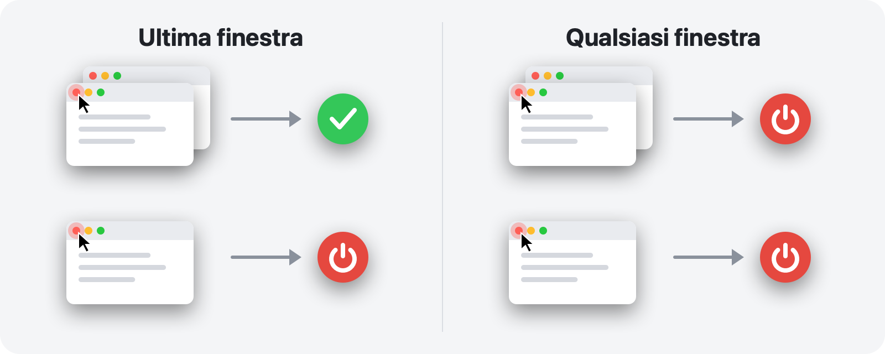

<p align="center">
  
</p>

<h1 align="center">RedQuit</h1>

<p align="center">
  <b>Chiudi la finestra, esci dall’app.</b><br>
  Il pulsante rosso del tuo Mac funziona come su Windows.
</p>

<p align="center">
  <a href="https://github.com/Toys-D/RedQuit/releases/latest"></a>
  
  
  
  <a href="../LICENSE"></a>
</p>

<p align="center">
  <a href="https://github.com/Toys-D/RedQuit/releases/latest"><b>Scarica RedQuit</b></a> · macOS 14 Sonoma o versioni successive · Apple Silicon e Intel · gratis
</p>

<p align="center">
  <a href="../README.md">English</a> ·
  <a href="README.ru.md">Русский</a> ·
  <a href="README.uk.md">Українська</a> ·
  <a href="README.es.md">Español</a> ·
  <a href="README.pt-BR.md">Português</a> ·
  <a href="README.fr.md">Français</a> ·
  <a href="README.de.md">Deutsch</a> ·
  <b>Italiano</b> ·
  <a href="README.pl.md">Polski</a> ·
  <a href="README.tr.md">Türkçe</a> ·
  <a href="README.ja.md">日本語</a> ·
  <a href="README.ko.md">한국어</a> ·
  <a href="README.zh-Hans.md">简体中文</a> ·
  <a href="README.zh-Hant.md">繁體中文</a> ·
  <a href="README.ar.md">العربية</a> ·
  <a href="README.hi.md">हिन्दी</a>
</p>


## Perché

Sul Mac il pulsante rosso chiude soltanto una finestra. L’app resta in esecuzione: rimane nel Dock, occupa memoria e aspetta che tu ne esca con ⌘Q. Se arrivi da Windows, o semplicemente ti aspetti che il pulsante rosso significhi “ho finito con questa app”, RedQuit fa per te.

RedQuit risiede nella barra dei menu e tiene d’occhio una sola cosa: un clic sul pulsante rosso di chiusura. Quando quel clic chiude l’ultima finestra dell’app, RedQuit chiude l’app.

## Cosa fa

- **Solo il pulsante rosso.** ⌘W e File ▸ Chiudi funzionano come prima. RedQuit reagisce solo a un clic del mouse sul pulsante rosso.
- **Aspetta che la finestra si chiuda davvero.** Se l’app chiede “Salvare le modifiche?” e fai clic su Annulla, non succede nulla.
- **Chiude l’app nel modo normale, come ⌘Q.** Le app continuano a chiedere cosa fare dei documenti non salvati. RedQuit non forza mai l’uscita da un’app.
- **Sa dove sono le tue finestre.** Le finestre ridotte nel Dock, quelle su altre scrivanie e quelle a tutto schermo contano come aperte.
- **Non tocca il Finder né il sistema.** Aggiungi le tue eccezioni con un clic.
- **Non ti intralcia.** Nessuna icona nel Dock, solo un piccolo simbolo nella barra dei menu.
- **Parla la tua lingua.** 16 lingue, secondo le impostazioni del tuo Mac.
- **Rispetta la privacy.** RedQuit legge solo informazioni sulle finestre. Non fa mai clic al posto tuo, non blocca né modifica mai i tuoi clic, non effettua connessioni di rete e non raccoglie nulla.

## Due modalità



| | **Ultima finestra** (predefinita) | **Qualsiasi finestra** |
|---|---|---|
| Pulsante rosso su una di più finestre | l’app resta aperta | l’app si chiude |
| Pulsante rosso sull’ultima finestra | l’app si chiude | l’app si chiude |
| Ideale per | l’uso quotidiano | le app che usi sempre con una sola finestra |

Cambia modalità dalla barra dei menu: RedQuit ▸ Modalità.

## Schermate

<picture>
  <source media="(prefers-color-scheme: dark)" srcset="../.github/screenshots/settings-dark.png">
  
</picture>

| | |
|:---:|:---:|
|  |  |
| **Il menu:** pausa, modalità, impostazioni | **Primo avvio:** un solo interruttore da attivare |

## Installazione

1. Scarica `RedQuit-1.0.1.dmg` dalla [pagina delle release](https://github.com/Toys-D/RedQuit/releases/latest) e trascina **RedQuit** in **Applicazioni**.
2. Apri RedQuit. Non ha un certificato Apple a pagamento, quindi la prima volta macOS si rifiuta di aprirlo. Vai in **Impostazioni di Sistema ▸ Privacy e sicurezza**, scorri verso il basso e fai clic su **Apri comunque**.
3. RedQuit chiede l’accesso ad Accessibilità. Fai clic su **Apri Impostazioni di Sistema** e attiva l’interruttore accanto a RedQuit in **Privacy e sicurezza ▸ Accessibilità**. RedQuit inizia subito a funzionare, senza bisogno di riavviare.
4. Facoltativo: nelle impostazioni di RedQuit, attiva **Apri al login**.

**Aggiornamento.** Esci da RedQuit dal suo menu e sostituisci l’app in Applicazioni. macOS considera ogni nuova versione come un’app nuova, quindi dopo un aggiornamento l’interruttore di Accessibilità smette di funzionare: seleziona RedQuit nell’elenco, rimuovilo con il pulsante **−** e attivalo di nuovo.

## Lingue

English, Русский, Українська, Español, Português (Brasil), Français, Deutsch, Italiano, Polski, Türkçe, 日本語, 한국어, 简体中文, 繁體中文, العربية, हिन्दी.

RedQuit segue la lingua del tuo Mac. Per scegliere un’altra lingua solo per RedQuit, vai in **Impostazioni di Sistema ▸ Generali ▸ Lingua e zona ▸ Applicazioni**. Le traduzioni sono state fatte con cura, ma non tutte da madrelingua: se qualcosa suona strano, [apri una issue](https://github.com/Toys-D/RedQuit/issues).

## Come funziona

1. Un monitor globale del mouse riceve copie dei tuoi clic. Non può ritardarli, bloccarli né modificarli.
2. A ogni clic, RedQuit chiede all’API di accessibilità di macOS cosa c’è sotto il puntatore. Interviene solo se si tratta del pulsante di chiusura di una finestra (`AXCloseButton`).
3. Se rilasci il pulsante del mouse lontano dal pulsante rosso, la chiusura viene annullata e RedQuit non fa nulla.
4. RedQuit aspetta che la finestra sia davvero sparita. Se l’app mostra “Salvare le modifiche?”, attende la tua risposta.
5. In modalità **Ultima finestra** conta le finestre rimaste dell’app: quelle normali e quelle ridotte nel Dock tramite Accessibilità, quelle su altre scrivanie e a tutto schermo tramite il window server.
6. Se non resta nulla (o in modalità **Qualsiasi finestra**), RedQuit chiede all’app di chiudersi, esattamente come ⌘Q.

Quando RedQuit non è sicuro, lascia l’app in esecuzione. Ogni decisione viene scritta nel log di sistema: apri **Console** e cerca `subsystem:com.pixmaplabs.RedQuit`.

## Compilare dal codice sorgente

Richiede Xcode 16 o versioni successive (Swift 6) su macOS 14 o versioni successive.

```bash
./Scripts/build.sh     # builds build/RedQuit.app
swift test             # unit tests
./Scripts/release.sh   # universal build and dist/RedQuit-<version>.dmg
```

`build.sh` firma l’app con il tuo certificato Apple Development, se ne hai uno, così il permesso di Accessibilità resta valido anche dopo una nuova compilazione. Se non ce l’hai, esegui `ADHOC=1 ./Scripts/build.sh`.

La licenza consente di compilare RedQuit per uso personale, ma non di modificarlo né di condividerne build modificate.

## Sostieni il progetto

RedQuit è gratuito. Se ti fa risparmiare qualche clic ogni giorno e vuoi dire grazie, puoi sostenerne lo sviluppo.

**[Sostieni con PayPal](https://www.paypal.com/cgi-bin/webscr?cmd=_xclick&business=pixmap1981%40gmail.com&item_name=RedQuit&currency_code=USD)** · Il sostegno è volontario; nulla nell’app dipende da esso.

## Contatti

Bug, domande, idee: **[pixmap1981@gmail.com](mailto:pixmap1981@gmail.com?subject=RedQuit)**, oppure apri una [issue](https://github.com/Toys-D/RedQuit/issues).

## Licenza

RedQuit è freeware. Puoi usarlo gratuitamente, a casa o al lavoro, e condividerne copie non modificate. Non puoi modificarlo, pubblicarne versioni modificate né venderlo. I termini completi si trovano nel file [LICENSE](../LICENSE). Fa fede solo il testo inglese di LICENSE; questo riepilogo è fornito per comodità.

---

<p align="center">
  <br>
  <sub>Creato da Pixmap Labs</sub>
</p>
