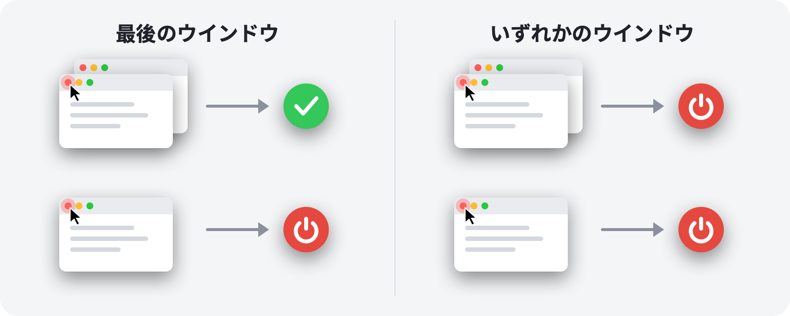

<p align="center">
  
</p>

<h1 align="center">RedQuit</h1>

<p align="center">
  <b>ウインドウを閉じれば、アプリも終了。</b><br>
  Macの赤いボタンが、Windowsと同じように働きます。
</p>

<p align="center">
  <a href="https://github.com/Toys-D/RedQuit/releases/latest"></a>
  
  
  
  <a href="../LICENSE"></a>
</p>

<p align="center">
  <a href="https://github.com/Toys-D/RedQuit/releases/latest"><b>RedQuitをダウンロード</b></a> · macOS 14 Sonoma以降 · AppleシリコンとIntel · 無料
</p>

<p align="center">
  <a href="../README.md">English</a> ·
  <a href="README.ru.md">Русский</a> ·
  <a href="README.uk.md">Українська</a> ·
  <a href="README.es.md">Español</a> ·
  <a href="README.pt-BR.md">Português</a> ·
  <a href="README.fr.md">Français</a> ·
  <a href="README.de.md">Deutsch</a> ·
  <a href="README.it.md">Italiano</a> ·
  <a href="README.pl.md">Polski</a> ·
  <a href="README.tr.md">Türkçe</a> ·
  <b>日本語</b> ·
  <a href="README.ko.md">한국어</a> ·
  <a href="README.zh-Hans.md">简体中文</a> ·
  <a href="README.zh-Hant.md">繁體中文</a> ·
  <a href="README.ar.md">العربية</a> ·
  <a href="README.hi.md">हिन्दी</a>
</p>


## なぜRedQuitなのか

Macでは、赤いボタンはウインドウを閉じるだけです。アプリは動き続け、Dockに残ったままメモリを使い続けて、⌘Qで終了されるのを待っています。Windowsから乗り換えた方や、赤いボタンは「このアプリはもう使い終わった」という意味だと考えている方には、RedQuitがぴったりです。

RedQuitはメニューバーに常駐し、ただ1つのこと、つまり赤いクローズボタンのクリックだけを見張っています。そのクリックでアプリの最後のウインドウが閉じると、RedQuitがアプリを終了します。

## 機能

- **赤いボタンだけ**：⌘Wや「ファイル」▸「閉じる」はこれまでどおり動作します。RedQuitが反応するのは、赤いボタンのマウスクリックだけです。
- **ウインドウが本当に閉じるまで待つ**：アプリが「変更を保存しますか？」と尋ねたときに「キャンセル」を押した場合は、何も起こりません。
- **⌘Qと同じ通常の方法で終了**：保存していない書類があれば、アプリはこれまでどおり確認してきます。RedQuitが何かを強制終了することはありません。
- **ウインドウのありかを把握**：しまわれたウインドウ、ほかのデスクトップにあるウインドウ、フルスクリーンのウインドウも、開いているものとして数えます。
- **Finderとシステムには手を出さない**：除外したいアプリもワンクリックで追加できます。
- **邪魔にならない**：Dockアイコンはなく、メニューバーに小さなアイコンが表示されるだけです。
- **あなたの言語で**：16言語に対応し、Macの設定に従って表示されます。
- **プライバシーを尊重**：RedQuitが読み取るのはウインドウに関する情報だけです。代わりに何かをクリックすることはなく、クリック操作をブロックしたり変更したりすることもありません。ネットワークに接続することも、データを収集することも一切ありません。

## 2つのモード



| | **最後のウインドウ**（デフォルト） | **いずれかのウインドウ** |
|---|---|---|
| 複数あるウインドウの1つで赤いボタン | アプリは動作し続ける | アプリが終了する |
| 最後のウインドウで赤いボタン | アプリが終了する | アプリが終了する |
| 向いている用途 | 普段使い | 常に1つのウインドウで使うアプリ |

モードはメニューバーから切り替えられます：RedQuit ▸ モード。

## スクリーンショット

<picture>
  <source media="(prefers-color-scheme: dark)" srcset="../.github/screenshots/settings-dark.png">
  
</picture>

| | |
|:---:|:---:|
|  |  |
| **メニュー**：一時停止、モード、設定 | **初回起動時**：オンにするスイッチは1つだけ |

## インストール

1. [リリースページ](https://github.com/Toys-D/RedQuit/releases/latest)から`RedQuit-1.0.0.dmg`をダウンロードし、**RedQuit**を**アプリケーション**フォルダにドラッグします。
2. RedQuitを開きます。RedQuitには有料のApple証明書がないため、初回はmacOSが開くのを拒否します。**システム設定 ▸ プライバシーとセキュリティ**を開き、下にスクロールして**このまま開く**をクリックします。
3. RedQuitがアクセシビリティのアクセス権を求めます。**システム設定を開く**をクリックし、**プライバシーとセキュリティ ▸ アクセシビリティ**でRedQuitの横にあるスイッチをオンにします。RedQuitはすぐに動作を開始します。再起動は必要ありません。
4. オプション：RedQuitの設定で**ログイン時に開く**をオンにします。

**アップデート**：メニューからRedQuitを終了し、アプリケーションフォルダ内のアプリを置き換えます。macOSは新しいバージョンをそれぞれ別のアプリとして扱うため、アップデート後はアクセシビリティのスイッチが機能しなくなります。リストでRedQuitを選択し、「**−**」ボタンで削除してから、もう一度オンにしてください。

## 言語

English, Русский, Українська, Español, Português (Brasil), Français, Deutsch, Italiano, Polski, Türkçe, 日本語, 한국어, 简体中文, 繁體中文, العربية, हिन्दी.

RedQuitはMacの言語に従います。RedQuitだけ別の言語にしたい場合は、**システム設定 ▸ 一般 ▸ 言語と地域 ▸ アプリケーション**で選択してください。翻訳は丁寧に行いましたが、すべてがネイティブスピーカーによるものではありません。不自然な表現があれば、[Issueを作成](https://github.com/Toys-D/RedQuit/issues)してお知らせください。

## 仕組み

1. グローバルなマウスモニタがクリックのコピーを受け取ります。モニタがクリックを遅らせたり、ブロックしたり、変更したりすることはできません。
2. クリックがあると、RedQuitはmacOSのアクセシビリティAPIに、ポインタの下に何があるかを問い合わせます。それがウインドウのクローズボタン（`AXCloseButton`）である場合にのみ動作します。
3. 赤いボタンから離れた場所でマウスボタンを放した場合は、閉じる操作がキャンセルされたので、RedQuitは何もしません。
4. RedQuitはウインドウが本当に消えるまで待ちます。アプリが「変更を保存しますか？」と表示した場合は、あなたの返答を待ちます。
5. **最後のウインドウ**モードでは、アプリに残っているウインドウを数えます。通常のウインドウとしまわれたウインドウはアクセシビリティ経由で、ほかのデスクトップにあるウインドウとフルスクリーンのウインドウはウインドウサーバ経由で確認します。
6. 何も残っていなければ（または**いずれかのウインドウ**モードの場合は）、RedQuitは⌘Qとまったく同じ方法でアプリに終了を要求します。

RedQuitは確信が持てないときは、必ずアプリをそのまま動作させておきます。すべての判断はシステムログに記録されます。**コンソール**を開いて`subsystem:com.toysforminds.RedQuit`を検索してください。

## ソースからビルド

macOS 14以降と、Xcode 16以降（Swift 6）が必要です。

```bash
./Scripts/build.sh     # builds build/RedQuit.app
swift test             # unit tests
./Scripts/release.sh   # universal build and dist/RedQuit-<version>.dmg
```

`build.sh`は、Apple Development証明書があればそれを使ってアプリに署名するため、再ビルドしてもアクセシビリティの許可が保持されます。証明書がない場合は、`ADHOC=1 ./Scripts/build.sh`を実行してください。

ライセンスでは、自分で使用するためにRedQuitをビルドすることは認められていますが、RedQuitを変更することや、変更したビルドを共有することは認められていません。

## プロジェクトを支援

RedQuitは無料です。毎日のクリックを少しでも減らせて、お礼を伝えたいと思っていただけたなら、開発を支援していただくこともできます。

**[PayPalで支援する](https://www.paypal.com/cgi-bin/webscr?cmd=_xclick&business=pixmap1981%40gmail.com&item_name=RedQuit&currency_code=USD)** · 支援は任意です。支援の有無によってアプリの機能が変わることは一切ありません。

## お問い合わせ

バグ報告、質問、アイデアは、メール（**[pixmap1981@gmail.com](mailto:pixmap1981@gmail.com?subject=RedQuit)**）でお送りいただくか、[Issue](https://github.com/Toys-D/RedQuit/issues)を作成してください。

## ライセンス

RedQuitはフリーウェアです。家庭でも職場でも無料で使用でき、変更していないコピーを共有することもできます。変更すること、変更したバージョンを公開すること、販売することはできません。全文は[LICENSE](../LICENSE)をご覧ください。この要約は参考のためのものであり、法的拘束力を持つのは英語のLICENSEです。

---

<p align="center">
  <br>
  <sub>制作：Toys for Minds</sub>
</p>
