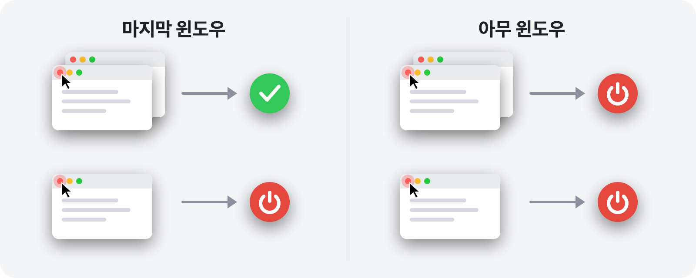

<p align="center">
  
</p>

<h1 align="center">RedQuit</h1>

<p align="center">
  <b>윈도우를 닫으면 앱도 종료됩니다.</b><br>
  Mac의 빨간색 버튼이 Windows에서처럼 작동합니다.
</p>

<p align="center">
  <a href="https://github.com/Toys-D/RedQuit/releases/latest"></a>
  
  
  
  <a href="../LICENSE"></a>
</p>

<p align="center">
  <a href="https://github.com/Toys-D/RedQuit/releases/latest"><b>RedQuit 다운로드</b></a> · macOS 14 Sonoma 이상 · Apple 실리콘 및 Intel · 무료
</p>

<p align="center">
  <a href="../README.md">English</a> ·
  <a href="README.ru.md">Русский</a> ·
  <a href="README.uk.md">Українська</a> ·
  <a href="README.es.md">Español</a> ·
  <a href="README.pt-BR.md">Português</a> ·
  <a href="README.fr.md">Français</a> ·
  <a href="README.de.md">Deutsch</a> ·
  <a href="README.it.md">Italiano</a> ·
  <a href="README.pl.md">Polski</a> ·
  <a href="README.tr.md">Türkçe</a> ·
  <a href="README.ja.md">日本語</a> ·
  <b>한국어</b> ·
  <a href="README.zh-Hans.md">简体中文</a> ·
  <a href="README.zh-Hant.md">繁體中文</a> ·
  <a href="README.ar.md">العربية</a> ·
  <a href="README.hi.md">हिन्दी</a>
</p>


## 왜 RedQuit인가요?

Mac에서 빨간색 버튼은 윈도우만 닫습니다. 앱은 계속 실행되어 Dock에 남아 있고, 메모리를 차지한 채 사용자가 ⌘Q로 종료할 때까지 기다립니다. Windows에서 넘어왔거나, 빨간색 버튼이 ‘이 앱은 다 썼어요’라는 뜻이기를 기대한다면 RedQuit이 딱 맞습니다.

RedQuit은 메뉴 막대에 머물며 단 한 가지, 빨간색 닫기 버튼의 클릭만 지켜봅니다. 그 클릭으로 앱의 마지막 윈도우가 닫히면 RedQuit이 앱을 종료합니다.

## 기능

- **빨간색 버튼에만 반응합니다.** ⌘W와 파일 ▸ 닫기는 이전과 똑같이 작동합니다. RedQuit은 빨간색 버튼을 마우스로 클릭할 때만 반응합니다.
- **윈도우가 실제로 닫힐 때까지 기다립니다.** 앱이 ‘변경 사항을 저장하겠습니까?’라고 물을 때 취소를 누르면 아무 일도 일어나지 않습니다.
- **⌘Q처럼 정상적인 방법으로 종료합니다.** 저장하지 않은 문서가 있으면 앱이 평소처럼 확인합니다. RedQuit은 어떤 앱도 강제 종료하지 않습니다.
- **윈도우가 어디에 있는지 압니다.** 최소화된 윈도우, 다른 데스크탑에 있는 윈도우, 전체 화면 윈도우도 열려 있는 것으로 간주합니다.
- **Finder와 시스템은 건드리지 않습니다.** 원하는 앱도 클릭 한 번으로 제외 항목에 추가할 수 있습니다.
- **방해가 되지 않습니다.** Dock 아이콘 없이 메뉴 막대에 작은 아이콘만 표시됩니다.
- **사용자의 언어를 지원합니다.** Mac 설정에 따라 16개 언어로 표시됩니다.
- **개인정보를 보호합니다.** RedQuit은 윈도우에 관한 정보만 읽습니다. 사용자를 대신해 무언가를 클릭하지 않고, 사용자의 클릭을 차단하거나 변경하지 않으며, 네트워크에 연결하지 않고, 아무것도 수집하지 않습니다.

## 두 가지 모드



| | **마지막 윈도우**(기본값) | **아무 윈도우** |
|---|---|---|
| 여러 윈도우 중 하나에서 빨간색 버튼 | 앱이 계속 실행됨 | 앱이 종료됨 |
| 마지막 윈도우에서 빨간색 버튼 | 앱이 종료됨 | 앱이 종료됨 |
| 적합한 용도 | 일상적인 사용 | 항상 윈도우 하나로만 쓰는 앱 |

모드는 메뉴 막대에서 전환할 수 있습니다: RedQuit ▸ 모드.

## 스크린샷

<picture>
  <source media="(prefers-color-scheme: dark)" srcset="../.github/screenshots/settings-dark.png">
  
</picture>

| | |
|:---:|:---:|
|  |  |
| **메뉴:** 일시 정지, 모드, 설정 | **처음 실행할 때:** 켜야 할 스위치는 하나뿐 |

## 설치

1. [릴리스 페이지](https://github.com/Toys-D/RedQuit/releases/latest)에서 `RedQuit-1.0.0.dmg`를 다운로드한 다음 **RedQuit**을 **응용 프로그램** 폴더로 드래그하세요.
2. RedQuit을 여세요. RedQuit에는 유료 Apple 인증서가 없기 때문에 처음에는 macOS가 열기를 거부합니다. **시스템 설정 ▸ 개인정보 보호 및 보안**으로 이동하여 아래로 스크롤한 다음 **그래도 열기**를 클릭하세요.
3. RedQuit이 손쉬운 사용 접근 권한을 요청합니다. **시스템 설정 열기**를 클릭하고 **개인정보 보호 및 보안 ▸ 손쉬운 사용**에서 RedQuit 옆의 스위치를 켜세요. RedQuit이 바로 작동을 시작하며, 다시 시작할 필요가 없습니다.
4. 선택 사항: RedQuit 설정에서 **로그인 시 열기**를 켜세요.

**업데이트.** 메뉴에서 RedQuit을 종료하고 응용 프로그램 폴더에 있는 앱을 교체하세요. macOS는 새 버전을 매번 새로운 앱으로 취급하므로 업데이트 후에는 손쉬운 사용 스위치가 작동하지 않습니다. 목록에서 RedQuit을 선택하고 **−** 버튼으로 제거한 다음 다시 켜세요.

## 언어

English, Русский, Українська, Español, Português (Brasil), Français, Deutsch, Italiano, Polski, Türkçe, 日本語, 한국어, 简体中文, 繁體中文, العربية, हिन्दी.

RedQuit은 Mac의 언어를 따릅니다. RedQuit에만 다른 언어를 사용하려면 **시스템 설정 ▸ 일반 ▸ 언어 및 지역 ▸ 응용 프로그램**으로 이동하세요. 번역은 정성껏 했지만 모두 원어민이 한 것은 아닙니다. 어색한 부분이 있다면 [이슈를 등록](https://github.com/Toys-D/RedQuit/issues)해 주세요.

## 작동 방식

1. 전역 마우스 모니터가 사용자 클릭의 사본을 받습니다. 이 모니터는 클릭을 지연시키거나 차단하거나 변경할 수 없습니다.
2. 클릭이 발생하면 RedQuit은 macOS의 손쉬운 사용 API에 포인터 아래에 무엇이 있는지 묻습니다. 그것이 윈도우의 닫기 버튼(`AXCloseButton`)일 때만 동작합니다.
3. 빨간색 버튼에서 벗어난 곳에서 마우스 버튼을 놓으면 닫기가 취소된 것이므로 RedQuit은 아무것도 하지 않습니다.
4. RedQuit은 윈도우가 실제로 사라질 때까지 기다립니다. 앱이 ‘변경 사항을 저장하겠습니까?’를 표시하면 사용자의 응답을 기다립니다.
5. **마지막 윈도우** 모드에서는 앱에 남아 있는 윈도우를 셉니다. 일반 윈도우와 최소화된 윈도우는 손쉬운 사용을 통해, 다른 데스크탑에 있는 윈도우와 전체 화면 윈도우는 윈도우 서버를 통해 확인합니다.
6. 남은 윈도우가 없으면(또는 **아무 윈도우** 모드에서는) RedQuit이 ⌘Q와 똑같은 방식으로 앱에 종료를 요청합니다.

RedQuit은 확실하지 않을 때는 언제나 앱을 그대로 실행 상태로 둡니다. 모든 판단은 시스템 로그에 기록됩니다. **콘솔**을 열고 `subsystem:com.toysforminds.RedQuit`을 검색하세요.

## 소스에서 빌드하기

macOS 14 이상에서 Xcode 16 이상(Swift 6)이 필요합니다.

```bash
./Scripts/build.sh     # builds build/RedQuit.app
swift test             # unit tests
./Scripts/release.sh   # universal build and dist/RedQuit-<version>.dmg
```

`build.sh`는 Apple Development 인증서가 있으면 그 인증서로 앱에 서명하므로, 다시 빌드해도 손쉬운 사용 권한이 유지됩니다. 인증서가 없다면 `ADHOC=1 ./Scripts/build.sh`를 실행하세요.

라이선스는 개인적인 용도로 RedQuit을 빌드하는 것은 허용하지만, RedQuit을 수정하거나 수정한 빌드를 공유하는 것은 허용하지 않습니다.

## 프로젝트 후원하기

RedQuit은 무료입니다. 매일 클릭 몇 번을 줄여 주어 고마운 마음을 전하고 싶다면 개발을 후원해 주실 수 있습니다.

**[PayPal로 후원하기](https://www.paypal.com/cgi-bin/webscr?cmd=_xclick&business=pixmap1981%40gmail.com&item_name=RedQuit&currency_code=USD)** · 후원은 자발적이며, 앱의 어떤 기능도 후원 여부에 좌우되지 않습니다.

## 문의하기

버그, 질문, 아이디어가 있다면 이메일(**[pixmap1981@gmail.com](mailto:pixmap1981@gmail.com?subject=RedQuit)**)로 보내 주시거나 [이슈](https://github.com/Toys-D/RedQuit/issues)를 등록해 주세요.

## 라이선스

RedQuit은 프리웨어입니다. 가정이나 직장에서 무료로 사용할 수 있으며, 수정하지 않은 사본을 공유할 수 있습니다. RedQuit을 수정하거나, 수정한 버전을 배포하거나, 판매하는 것은 허용되지 않습니다. 전체 조건은 [LICENSE](../LICENSE)에서 확인할 수 있습니다. 이 요약은 편의를 위해 제공되며, 법적 효력을 갖는 것은 영문 LICENSE입니다.

---

<p align="center">
  <br>
  <sub>제작: Toys for Minds</sub>
</p>
