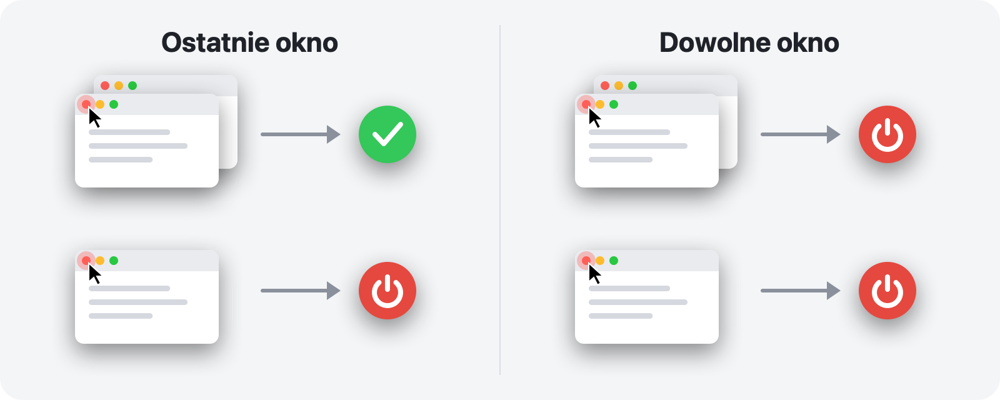

<p align="center">
  
</p>

<h1 align="center">RedQuit</h1>

<p align="center">
  <b>Zamknij okno, zakończ aplikację.</b><br>
  Czerwony przycisk na Twoim Macu działa tak jak w Windows.
</p>

<p align="center">
  <a href="https://github.com/Toys-D/RedQuit/releases/latest"></a>
  
  
  
  <a href="../LICENSE"></a>
</p>

<p align="center">
  <a href="https://github.com/Toys-D/RedQuit/releases/latest"><b>Pobierz RedQuit</b></a> · macOS 14 Sonoma lub nowszy · Apple Silicon i Intel · za darmo
</p>

<p align="center">
  <a href="../README.md">English</a> ·
  <a href="README.ru.md">Русский</a> ·
  <a href="README.uk.md">Українська</a> ·
  <a href="README.es.md">Español</a> ·
  <a href="README.pt-BR.md">Português</a> ·
  <a href="README.fr.md">Français</a> ·
  <a href="README.de.md">Deutsch</a> ·
  <a href="README.it.md">Italiano</a> ·
  <b>Polski</b> ·
  <a href="README.tr.md">Türkçe</a> ·
  <a href="README.ja.md">日本語</a> ·
  <a href="README.ko.md">한국어</a> ·
  <a href="README.zh-Hans.md">简体中文</a> ·
  <a href="README.zh-Hant.md">繁體中文</a> ·
  <a href="README.ar.md">العربية</a> ·
  <a href="README.hi.md">हिन्दी</a>
</p>


## Dlaczego

Na Macu czerwony przycisk tylko zamyka okno. Aplikacja nadal działa: zostaje w Docku, zajmuje pamięć i czeka, aż zakończysz ją skrótem ⌘Q. Jeśli przesiadasz się z Windows albo po prostu oczekujesz, że czerwony przycisk oznacza „kończę pracę z tą aplikacją”, RedQuit jest dla Ciebie.

RedQuit działa na pasku menu i obserwuje tylko jedno: kliknięcie czerwonego przycisku zamykania. Gdy to kliknięcie zamknie ostatnie okno aplikacji, RedQuit kończy jej działanie.

## Co robi

- **Tylko czerwony przycisk.** ⌘W i Plik ▸ Zamknij działają jak dotąd. RedQuit reaguje wyłącznie na kliknięcie myszą czerwonego przycisku.
- **Czeka, aż okno naprawdę się zamknie.** Jeśli aplikacja zapyta „Zachować zmiany?”, a Ty klikniesz Anuluj, nic się nie stanie.
- **Kończy działanie aplikacji w zwykły sposób, jak ⌘Q.** Aplikacje nadal pytają o niezachowane dokumenty. RedQuit nigdy nie wymusza zakończenia żadnej aplikacji.
- **Wie, gdzie są Twoje okna.** Okna zminimalizowane, okna na innych biurkach i okna w trybie pełnoekranowym liczą się jako otwarte.
- **Nie rusza Findera ani systemu.** Własne wyjątki dodasz jednym kliknięciem.
- **Nie przeszkadza.** Bez ikony w Docku, tylko mały znaczek na pasku menu.
- **Mówi Twoim językiem.** 16 języków, zgodnie z ustawieniami Twojego Maca.
- **Prywatny.** RedQuit jedynie odczytuje informacje o oknach. Nigdy niczego nie klika za Ciebie, nigdy nie blokuje ani nie zmienia Twoich kliknięć, nie łączy się z siecią i niczego nie zbiera.

## Dwa tryby



| | **Ostatnie okno** (domyślny) | **Dowolne okno** |
|---|---|---|
| Czerwony przycisk w jednym z kilku okien | aplikacja nadal działa | aplikacja kończy działanie |
| Czerwony przycisk w ostatnim oknie | aplikacja kończy działanie | aplikacja kończy działanie |
| Najlepszy do | codziennej pracy | aplikacji, których zawsze używasz w jednym oknie |

Tryb zmienisz na pasku menu: RedQuit ▸ Tryb.

## Zrzuty ekranu

<picture>
  <source media="(prefers-color-scheme: dark)" srcset="../.github/screenshots/settings-dark.png">
  
</picture>

| | |
|:---:|:---:|
|  |  |
| **Menu:** wstrzymanie, tryb, ustawienia | **Pierwsze uruchomienie:** wystarczy włączyć jeden przełącznik |

## Instalacja

1. Pobierz `RedQuit-1.0.0.dmg` ze [strony wydań](https://github.com/Toys-D/RedQuit/releases/latest) i przeciągnij **RedQuit** do folderu **Aplikacje**.
2. Otwórz RedQuit. Aplikacja nie ma płatnego certyfikatu Apple, więc za pierwszym razem macOS odmówi jej otwarcia. Otwórz **Ustawienia systemowe ▸ Prywatność i ochrona**, przewiń w dół i kliknij **Otwórz mimo to**.
3. RedQuit poprosi o uprawnienia dostępności. Kliknij **Otwórz Ustawienia systemowe** i włącz przełącznik obok RedQuit w sekcji **Prywatność i ochrona ▸ Dostępność**. RedQuit od razu zacznie działać, bez ponownego uruchamiania.
4. Opcjonalnie: w ustawieniach RedQuit włącz **Otwieraj podczas logowania**.

**Uaktualnianie.** Zakończ RedQuit z jego menu i zastąp aplikację w folderze Aplikacje. macOS traktuje każdą nową wersję jak nową aplikację, dlatego po uaktualnieniu przełącznik dostępności przestaje działać: zaznacz RedQuit na liście, usuń go przyciskiem **−** i włącz ponownie.

## Języki

English, Русский, Українська, Español, Português (Brasil), Français, Deutsch, Italiano, Polski, Türkçe, 日本語, 한국어, 简体中文, 繁體中文, العربية, हिन्दी.

RedQuit używa języka Twojego Maca. Aby wybrać inny język tylko dla RedQuit, otwórz **Ustawienia systemowe ▸ Ogólne ▸ Język i region ▸ Aplikacje**. Tłumaczenia zostały przygotowane starannie, ale nie wszystkie przez rodzimych użytkowników języka: jeśli coś brzmi dziwnie, [zgłoś to](https://github.com/Toys-D/RedQuit/issues).

## Jak to działa

1. Globalny monitor myszy otrzymuje kopie Twoich kliknięć. Nie może ich opóźnić, zablokować ani zmienić.
2. Po kliknięciu RedQuit pyta interfejs API dostępności macOS, co znajduje się pod wskaźnikiem. Działa tylko wtedy, gdy jest to przycisk zamykania okna (`AXCloseButton`).
3. Jeśli zwolnisz przycisk myszy poza czerwonym przyciskiem, zamknięcie zostaje anulowane i RedQuit nic nie robi.
4. RedQuit czeka, aż okno naprawdę zniknie. Jeśli aplikacja wyświetli pytanie „Zachować zmiany?”, czeka na Twoją odpowiedź.
5. W trybie **Ostatnie okno** liczy pozostałe okna aplikacji: zwykłe i zminimalizowane za pomocą API dostępności, a okna na innych biurkach i w trybie pełnoekranowym za pomocą serwera okien.
6. Jeśli nic nie zostało (lub w trybie **Dowolne okno**), RedQuit prosi aplikację o zakończenie działania, dokładnie tak jak ⌘Q.

Gdy RedQuit nie ma pewności, zostawia aplikację uruchomioną. Każda decyzja jest zapisywana w dzienniku systemowym: otwórz aplikację **Konsola** i wyszukaj `subsystem:com.toysforminds.RedQuit`.

## Budowanie ze źródeł

Wymaga Xcode 16 lub nowszego (Swift 6) w systemie macOS 14 lub nowszym.

```bash
./Scripts/build.sh     # builds build/RedQuit.app
swift test             # unit tests
./Scripts/release.sh   # universal build and dist/RedQuit-<version>.dmg
```

`build.sh` podpisuje aplikację Twoim certyfikatem Apple Development, jeśli go masz, dzięki czemu uprawnienia dostępności przetrwają ponowne kompilacje. Jeśli go nie masz, uruchom `ADHOC=1 ./Scripts/build.sh`.

Licencja pozwala budować RedQuit na własny użytek, ale nie pozwala go zmieniać ani udostępniać zmienionych kompilacji.

## Wesprzyj projekt

RedQuit jest darmowy. Jeśli każdego dnia oszczędza Ci kilka kliknięć i chcesz podziękować, możesz wesprzeć jego rozwój.

**[Wesprzyj przez PayPal](https://www.paypal.com/cgi-bin/webscr?cmd=_xclick&business=pixmap1981%40gmail.com&item_name=RedQuit&currency_code=USD)** · Wsparcie jest dobrowolne; nic w aplikacji od niego nie zależy.

## Kontakt

Błędy, pytania, pomysły: **[pixmap1981@gmail.com](mailto:pixmap1981@gmail.com?subject=RedQuit)** lub utwórz [zgłoszenie](https://github.com/Toys-D/RedQuit/issues).

## Licencja

RedQuit to freeware. Możesz używać go bezpłatnie, w domu lub w pracy, i udostępniać niezmienione kopie. Nie wolno go zmieniać, publikować zmienionych wersji ani sprzedawać. Pełne warunki znajdziesz w pliku [LICENSE](../LICENSE). Wiążący jest angielski tekst pliku LICENSE; to podsumowanie ma charakter wyłącznie pomocniczy.

---

<p align="center">
  <br>
  <sub>Stworzone przez Toys for Minds</sub>
</p>
