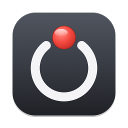
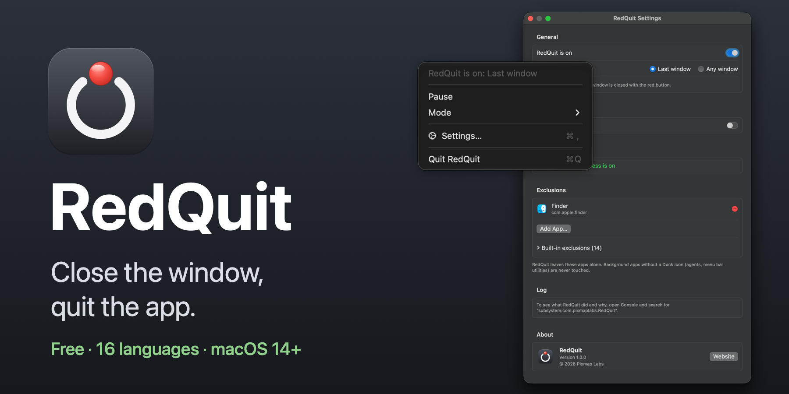
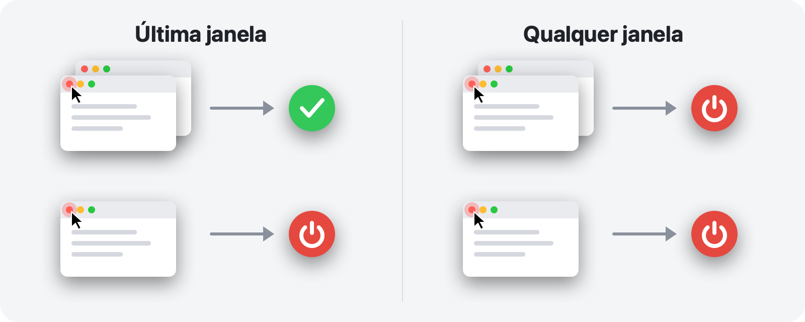
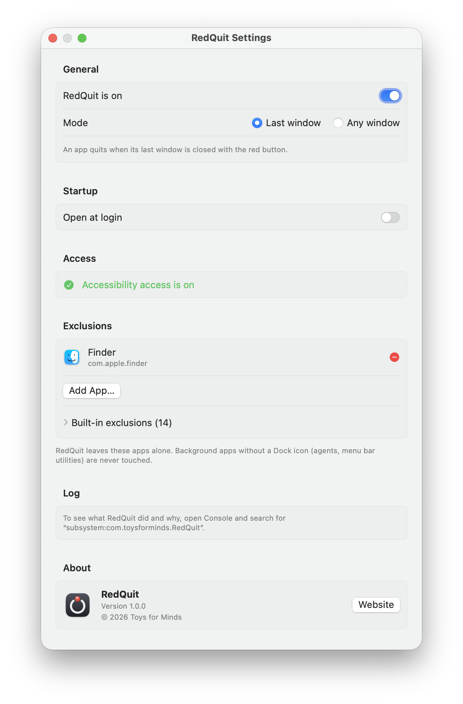
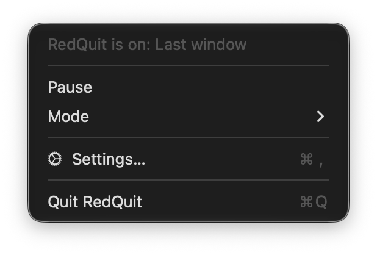
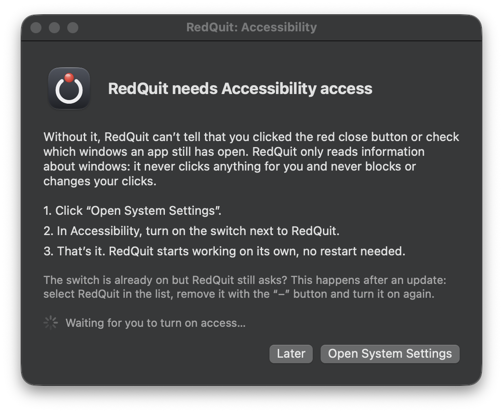

<p align="center">
  
</p>

<h1 align="center">RedQuit</h1>

<p align="center">
  <b>Feche a janela, encerre o app.</b><br>
  O botão vermelho do seu Mac funciona como no Windows.
</p>

<p align="center">
  <a href="https://github.com/Toys-D/RedQuit/releases/latest"></a>
  
  
  
  <a href="../LICENSE"></a>
</p>

<p align="center">
  <a href="https://github.com/Toys-D/RedQuit/releases/latest"><b>Baixar o RedQuit</b></a> · macOS 14 Sonoma ou posterior · Apple Silicon e Intel · grátis
</p>

<p align="center">
  <a href="../README.md">English</a> ·
  <a href="README.ru.md">Русский</a> ·
  <a href="README.uk.md">Українська</a> ·
  <a href="README.es.md">Español</a> ·
  <b>Português</b> ·
  <a href="README.fr.md">Français</a> ·
  <a href="README.de.md">Deutsch</a> ·
  <a href="README.it.md">Italiano</a> ·
  <a href="README.pl.md">Polski</a> ·
  <a href="README.tr.md">Türkçe</a> ·
  <a href="README.ja.md">日本語</a> ·
  <a href="README.ko.md">한국어</a> ·
  <a href="README.zh-Hans.md">简体中文</a> ·
  <a href="README.zh-Hant.md">繁體中文</a> ·
  <a href="README.ar.md">العربية</a> ·
  <a href="README.hi.md">हिन्दी</a>
</p>



## Por quê

No Mac, o botão vermelho apenas fecha a janela. O app continua em execução: permanece no Dock, ocupa memória e espera até que você o encerre com ⌘Q. Se você veio do Windows, ou simplesmente espera que o botão vermelho signifique “terminei com este app”, o RedQuit é para você.

O RedQuit fica na barra de menus e observa uma única coisa: um clique no botão vermelho de fechar. Quando esse clique fecha a última janela do app, o RedQuit encerra o app.

## O que ele faz

- **Só o botão vermelho.** ⌘W e Arquivo ▸ Fechar funcionam como antes. O RedQuit reage apenas a um clique do mouse no botão vermelho.
- **Espera a janela fechar de verdade.** Se o app perguntar “Salvar alterações?” e você clicar em Cancelar, nada acontece.
- **Encerra do jeito normal, como ⌘Q.** Os apps continuam perguntando sobre documentos não salvos. O RedQuit nunca força o encerramento de nada.
- **Sabe onde estão suas janelas.** Janelas minimizadas, janelas em outras mesas e janelas em tela cheia contam como abertas.
- **Não mexe no Finder nem no sistema.** Adicione suas próprias exceções com um clique.
- **Não atrapalha.** Sem ícone no Dock, apenas um pequeno símbolo na barra de menus.
- **Fala o seu idioma.** 16 idiomas, de acordo com os ajustes do seu Mac.
- **Privado.** O RedQuit apenas lê informações sobre janelas. Ele nunca clica em nada por você, nunca bloqueia nem altera seus cliques, não faz conexões de rede e não coleta nada.

## Dois modos



| | **Última janela** (padrão) | **Qualquer janela** |
|---|---|---|
| Botão vermelho em uma de várias janelas | o app continua em execução | o app é encerrado |
| Botão vermelho na última janela | o app é encerrado | o app é encerrado |
| Ideal para | o uso diário | apps que você sempre usa com uma única janela |

Mude de modo na barra de menus: RedQuit ▸ Modo.

## Capturas de tela

<picture>
  <source media="(prefers-color-scheme: dark)" srcset="../.github/screenshots/settings-dark.png">
  
</picture>

| | |
|:---:|:---:|
|  |  |
| **O menu:** pausar, modo, ajustes | **Primeira abertura:** basta ativar uma opção |

## Instalação

1. Baixe `RedQuit-1.0.0.dmg` na [página de versões](https://github.com/Toys-D/RedQuit/releases/latest) e arraste o **RedQuit** para **Aplicativos**.
2. Abra o RedQuit. Ele não tem um certificado pago da Apple, por isso, na primeira vez, o macOS se recusa a abri-lo. Vá em **Ajustes do Sistema ▸ Privacidade e Segurança**, role para baixo e clique em **Abrir Mesmo Assim**.
3. O RedQuit pede acesso à Acessibilidade. Clique em **Abrir Ajustes do Sistema** e ative a opção ao lado do RedQuit em **Privacidade e Segurança ▸ Acessibilidade**. O RedQuit começa a funcionar na hora, sem precisar reiniciar.
4. Opcional: nos ajustes do RedQuit, ative **Abrir no início da sessão**.

**Atualização.** Encerre o RedQuit pelo menu dele e substitua o app em Aplicativos. O macOS trata cada nova versão como um app novo, por isso a opção de Acessibilidade para de funcionar após uma atualização: selecione o RedQuit na lista, remova-o com o botão **−** e ative-o novamente.

## Idiomas

English, Русский, Українська, Español, Português (Brasil), Français, Deutsch, Italiano, Polski, Türkçe, 日本語, 한국어, 简体中文, 繁體中文, العربية, हिन्दी.

O RedQuit segue o idioma do seu Mac. Para escolher outro idioma apenas para o RedQuit, vá em **Ajustes do Sistema ▸ Geral ▸ Idioma e Região ▸ Aplicativos**. As traduções foram feitas com cuidado, mas nem todas por falantes nativos: se algo soar estranho, [abra uma issue](https://github.com/Toys-D/RedQuit/issues).

## Como funciona

1. Um monitor global do mouse recebe cópias dos seus cliques. Ele não pode atrasá-los, bloqueá-los nem alterá-los.
2. A cada clique, o RedQuit pergunta à API de Acessibilidade do macOS o que está sob o ponteiro. Ele só age se for o botão de fechar de uma janela (`AXCloseButton`).
3. Se você soltar o botão do mouse fora do botão vermelho, o fechamento foi cancelado e o RedQuit não faz nada.
4. O RedQuit espera até que a janela realmente desapareça. Se o app mostrar “Salvar alterações?”, ele aguarda a sua resposta.
5. No modo **Última janela**, ele conta as janelas restantes do app: as normais e as minimizadas pela Acessibilidade, e as janelas em outras mesas e em tela cheia pelo servidor de janelas.
6. Se não sobrar nenhuma (ou no modo **Qualquer janela**), o RedQuit pede ao app que seja encerrado, exatamente como ⌘Q.

Sempre que o RedQuit não tem certeza, ele deixa o app em execução. Cada decisão é registrada no log do sistema: abra o **Console** e busque `subsystem:com.toysforminds.RedQuit`.

## Compilar a partir do código-fonte

Requer Xcode 16 ou posterior (Swift 6) no macOS 14 ou posterior.

```bash
./Scripts/build.sh     # builds build/RedQuit.app
swift test             # unit tests
./Scripts/release.sh   # universal build and dist/RedQuit-<version>.dmg
```

O `build.sh` assina o app com o seu certificado Apple Development, se você tiver um, para que a permissão de Acessibilidade se mantenha entre as recompilações. Sem ele, execute `ADHOC=1 ./Scripts/build.sh`.

A licença permite compilar o RedQuit para uso próprio, mas não modificá-lo nem compartilhar compilações modificadas.

## Apoie o projeto

O RedQuit é gratuito. Se ele economiza alguns cliques todos os dias e você gostaria de agradecer, pode apoiar o seu desenvolvimento.

**[Apoiar via PayPal](https://www.paypal.com/cgi-bin/webscr?cmd=_xclick&business=pixmap1981%40gmail.com&item_name=RedQuit&currency_code=USD)** · O apoio é voluntário; nada no app depende dele.

## Contato

Bugs, dúvidas, ideias: **[pixmap1981@gmail.com](mailto:pixmap1981@gmail.com?subject=RedQuit)**, ou abra uma [issue](https://github.com/Toys-D/RedQuit/issues).

## Licença

O RedQuit é freeware. Você pode usá-lo gratuitamente, em casa ou no trabalho, e compartilhar cópias não modificadas. Você não pode modificá-lo, publicar versões modificadas nem vendê-lo. Os termos completos estão em [LICENSE](../LICENSE). Prevalece o texto em inglês do arquivo LICENSE; este resumo é fornecido apenas por conveniência.

---

<p align="center">
  <br>
  <sub>Feito por Toys for Minds</sub>
</p>
