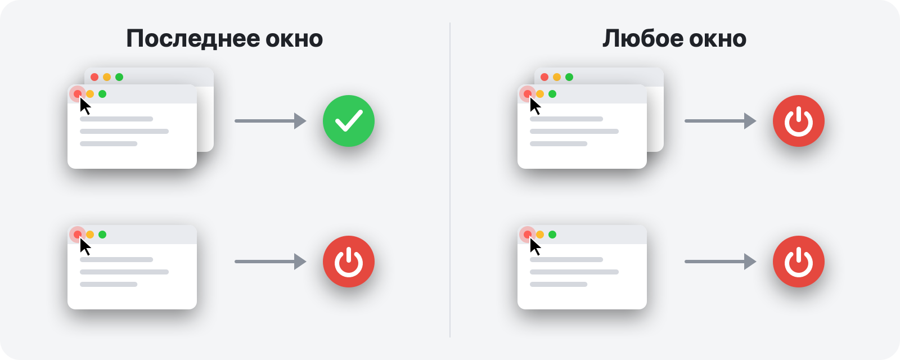

<p align="center">
  
</p>

<h1 align="center">RedQuit</h1>

<p align="center">
  <b>Закрыли окно — завершили приложение.</b><br>
  Красная кнопка на вашем Mac работает так же, как в Windows.
</p>

<p align="center">
  <a href="https://github.com/Toys-D/RedQuit/releases/latest"></a>
  
  
  
  <a href="../LICENSE"></a>
</p>

<p align="center">
  <a href="https://github.com/Toys-D/RedQuit/releases/latest"><b>Скачать RedQuit</b></a> · macOS 14 Sonoma или новее · Apple Silicon и Intel · бесплатно
</p>

<p align="center">
  <a href="../README.md">English</a> ·
  <b>Русский</b> ·
  <a href="README.uk.md">Українська</a> ·
  <a href="README.es.md">Español</a> ·
  <a href="README.pt-BR.md">Português</a> ·
  <a href="README.fr.md">Français</a> ·
  <a href="README.de.md">Deutsch</a> ·
  <a href="README.it.md">Italiano</a> ·
  <a href="README.pl.md">Polski</a> ·
  <a href="README.tr.md">Türkçe</a> ·
  <a href="README.ja.md">日本語</a> ·
  <a href="README.ko.md">한국어</a> ·
  <a href="README.zh-Hans.md">简体中文</a> ·
  <a href="README.zh-Hant.md">繁體中文</a> ·
  <a href="README.ar.md">العربية</a> ·
  <a href="README.hi.md">हिन्दी</a>
</p>


## Зачем

На Mac красная кнопка только закрывает окно. Приложение продолжает работать: остается в Dock, занимает память и ждет, пока вы завершите его через ⌘Q. Если вы перешли с Windows или просто ждете, что красная кнопка означает «работа с этим приложением закончена», RedQuit для вас.

RedQuit живет в строке меню и следит только за одним: нажатием красной кнопки закрытия. Если это нажатие закрывает последнее окно приложения, RedQuit завершает приложение.

## Что он делает

- **Только красная кнопка.** ⌘W и «Файл ▸ Закрыть» работают как прежде. RedQuit реагирует только на нажатие красной кнопки мышью.
- **Ждет, пока окно действительно закроется.** Если приложение спрашивает «Сохранить изменения?», а вы нажимаете «Отменить», ничего не происходит.
- **Завершает приложение обычным способом, как ⌘Q.** Приложения по-прежнему спрашивают о несохраненных документах. RedQuit никогда ничего не завершает принудительно.
- **Знает, где ваши окна.** Свернутые окна, окна на других рабочих столах и в полноэкранном режиме считаются открытыми.
- **Не трогает Finder и систему.** Свои исключения можно добавить одним нажатием.
- **Не мешает.** Никакого значка в Dock, только маленький символ в строке меню.
- **Говорит на вашем языке.** 16 языков, в соответствии с настройками вашего Mac.
- **Конфиденциальность.** RedQuit только считывает информацию об окнах. Он никогда ничего не нажимает за вас, не блокирует и не изменяет ваши нажатия, не подключается к сети и ничего не собирает.

## Два режима



| | **Последнее окно** (по умолчанию) | **Любое окно** |
|---|---|---|
| Красная кнопка на одном из нескольких окон | приложение продолжает работать | приложение завершается |
| Красная кнопка на последнем окне | приложение завершается | приложение завершается |
| Подходит для | повседневной работы | приложений, которыми вы всегда пользуетесь в одном окне |

Режим переключается в строке меню: RedQuit ▸ Режим.

## Снимки экрана

<picture>
  <source media="(prefers-color-scheme: dark)" srcset="../.github/screenshots/settings-dark.png">
  
</picture>

| | |
|:---:|:---:|
|  |  |
| **Меню:** пауза, режим, настройки | **Первый запуск:** нужно включить всего один переключатель |

## Установка

1. Скачайте `RedQuit-1.0.0.dmg` со [страницы выпусков](https://github.com/Toys-D/RedQuit/releases/latest) и перетащите **RedQuit** в папку **Программы**.
2. Откройте RedQuit. У него нет платного сертификата Apple, поэтому в первый раз macOS откажется его открывать. Перейдите в **Системные настройки ▸ Конфиденциальность и безопасность**, прокрутите вниз и нажмите **Все равно открыть**.
3. RedQuit запросит универсальный доступ. Нажмите **Открыть Системные настройки** и включите переключатель рядом с RedQuit в разделе **Конфиденциальность и безопасность ▸ Универсальный доступ**. RedQuit сразу начнет работать, перезапуск не нужен.
4. По желанию: в настройках RedQuit включите **Открывать при входе**.

**Обновление.** Завершите RedQuit через его меню и замените приложение в папке «Программы». macOS считает каждую новую версию новым приложением, поэтому после обновления переключатель универсального доступа перестает действовать: выберите RedQuit в списке, удалите его кнопкой **−** и включите снова.

## Языки

English, Русский, Українська, Español, Português (Brasil), Français, Deutsch, Italiano, Polski, Türkçe, 日本語, 한국어, 简体中文, 繁體中文, العربية, हिन्दी.

RedQuit использует язык вашего Mac. Чтобы выбрать другой язык только для RedQuit, откройте **Системные настройки ▸ Основные ▸ Язык и регион ▸ Программы**. Переводы сделаны тщательно, но не все — носителями языка: если что-то звучит странно, пожалуйста, [создайте issue](https://github.com/Toys-D/RedQuit/issues).

## Как это работает

1. Глобальный монитор мыши получает копии ваших нажатий. Он не может задержать, заблокировать или изменить их.
2. При нажатии RedQuit спрашивает у API универсального доступа macOS, что находится под указателем. Он действует, только если это кнопка закрытия окна (`AXCloseButton`).
3. Если вы отпустили кнопку мыши не над красной кнопкой, закрытие отменено, и RedQuit ничего не делает.
4. RedQuit ждет, пока окно действительно исчезнет. Если приложение показывает «Сохранить изменения?», он ждет вашего ответа.
5. В режиме **Последнее окно** он считает оставшиеся окна приложения: обычные и свернутые — через универсальный доступ, а окна на других рабочих столах и в полноэкранном режиме — через оконный сервер.
6. Если окон не осталось (или в режиме **Любое окно**), RedQuit просит приложение завершиться — точно так же, как ⌘Q.

Если RedQuit в чем-то не уверен, он оставляет приложение работать. Каждое решение записывается в системный журнал: откройте **Консоль** и введите в поиске `subsystem:com.toysforminds.RedQuit`.

## Сборка из исходного кода

Нужен Xcode 16 или новее (Swift 6) на macOS 14 или новее.

```bash
./Scripts/build.sh     # builds build/RedQuit.app
swift test             # unit tests
./Scripts/release.sh   # universal build and dist/RedQuit-<version>.dmg
```

`build.sh` подписывает приложение вашим сертификатом Apple Development, если он у вас есть, поэтому разрешение универсального доступа сохраняется после пересборки. Если сертификата нет, запустите `ADHOC=1 ./Scripts/build.sh`.

Лицензия разрешает собирать RedQuit для личного использования, но не изменять его и не распространять измененные сборки.

## Поддержать проект

RedQuit бесплатен. Если он каждый день экономит вам несколько нажатий и вы хотите сказать спасибо, вы можете поддержать его разработку.

**[Поддержать через PayPal](https://www.paypal.com/cgi-bin/webscr?cmd=_xclick&business=pixmap1981%40gmail.com&item_name=RedQuit&currency_code=USD)** · Поддержка добровольная, от нее ничего в приложении не зависит.

## Связь

Ошибки, вопросы, идеи: **[pixmap1981@gmail.com](mailto:pixmap1981@gmail.com?subject=RedQuit)** или создайте [issue](https://github.com/Toys-D/RedQuit/issues).

## Лицензия

RedQuit — бесплатная программа (freeware). Вы можете пользоваться ею бесплатно дома или на работе и распространять неизмененные копии. Вы не можете изменять ее, публиковать измененные версии или продавать ее. Полные условия приведены в файле [LICENSE](../LICENSE). Юридическую силу имеет английский текст LICENSE, а этот краткий пересказ приведен для удобства.

---

<p align="center">
  <br>
  <sub>Создано Toys for Minds</sub>
</p>
