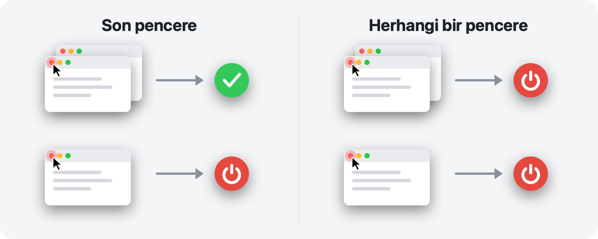

<p align="center">
  
</p>

<h1 align="center">RedQuit</h1>

<p align="center">
  <b>Pencereyi kapatın, uygulamadan çıkın.</b><br>
  Mac’inizdeki kırmızı düğme Windows’taki gibi çalışır.
</p>

<p align="center">
  <a href="https://github.com/Toys-D/RedQuit/releases/latest"></a>
  
  
  
  <a href="../LICENSE"></a>
</p>

<p align="center">
  <a href="https://github.com/Toys-D/RedQuit/releases/latest"><b>RedQuit’i indirin</b></a> · macOS 14 Sonoma veya daha yenisi · Apple Silicon ve Intel · ücretsiz
</p>

<p align="center">
  <a href="../README.md">English</a> ·
  <a href="README.ru.md">Русский</a> ·
  <a href="README.uk.md">Українська</a> ·
  <a href="README.es.md">Español</a> ·
  <a href="README.pt-BR.md">Português</a> ·
  <a href="README.fr.md">Français</a> ·
  <a href="README.de.md">Deutsch</a> ·
  <a href="README.it.md">Italiano</a> ·
  <a href="README.pl.md">Polski</a> ·
  <b>Türkçe</b> ·
  <a href="README.ja.md">日本語</a> ·
  <a href="README.ko.md">한국어</a> ·
  <a href="README.zh-Hans.md">简体中文</a> ·
  <a href="README.zh-Hant.md">繁體中文</a> ·
  <a href="README.ar.md">العربية</a> ·
  <a href="README.hi.md">हिन्दी</a>
</p>


## Neden

Mac’te kırmızı düğme yalnızca pencereyi kapatır. Uygulama çalışmaya devam eder: Dock’ta kalır, bellek kullanır ve ⌘Q ile ondan çıkmanızı bekler. Windows’tan geldiyseniz ya da kırmızı düğmenin “bu uygulamayla işim bitti” anlamına gelmesini bekliyorsanız RedQuit tam size göre.

RedQuit menü çubuğunda durur ve yalnızca tek bir şeyi izler: kırmızı kapatma düğmesine yapılan tıklamayı. Bu tıklama uygulamanın son penceresini kapattığında RedQuit uygulamadan çıkar.

## Ne yapar

- **Yalnızca kırmızı düğme.** ⌘W ve Dosya ▸ Kapat eskisi gibi çalışır. RedQuit yalnızca kırmızı düğmeye fareyle yapılan tıklamaya tepki verir.
- **Pencerenin gerçekten kapanmasını bekler.** Uygulama “Değişiklikler kaydedilsin mi?” diye sorduğunda Vazgeç’e basarsanız hiçbir şey olmaz.
- **⌘Q gibi, olağan yoldan çıkar.** Uygulamalar kaydedilmemiş belgeleri yine sorar. RedQuit hiçbir şeyi çıkmaya zorlamaz.
- **Pencerelerinizin nerede olduğunu bilir.** Simge durumuna küçültülmüş pencereler, diğer masaüstlerindeki pencereler ve tam ekran pencereler açık sayılır.
- **Finder’a ve sisteme dokunmaz.** Kendi istisnalarınızı tek tıklamayla ekleyin.
- **Göze batmaz.** Dock simgesi yoktur, yalnızca menü çubuğunda küçük bir işaret bulunur.
- **Dilinizi konuşur.** Mac’inizin ayarlarına göre 16 dil.
- **Gizliliğe saygılı.** RedQuit yalnızca pencerelerle ilgili bilgileri okur. Hiçbir zaman sizin yerinize bir şey tıklamaz, tıklamalarınızı engellemez veya değiştirmez, ağ bağlantısı kurmaz ve hiçbir şey toplamaz.

## İki mod



| | **Son pencere** (varsayılan) | **Herhangi bir pencere** |
|---|---|---|
| Birkaç pencereden birinde kırmızı düğme | uygulama çalışmaya devam eder | uygulamadan çıkılır |
| Son pencerede kırmızı düğme | uygulamadan çıkılır | uygulamadan çıkılır |
| Şunlar için ideal | günlük kullanım | her zaman tek pencereyle kullandığınız uygulamalar |

Modu menü çubuğundan değiştirin: RedQuit ▸ Mod.

## Ekran resimleri

<picture>
  <source media="(prefers-color-scheme: dark)" srcset="../.github/screenshots/settings-dark.png">
  
</picture>

| | |
|:---:|:---:|
|  |  |
| **Menü:** duraklatma, mod, ayarlar | **İlk açılış:** açılacak tek bir anahtar |

## Kurulum

1. `RedQuit-1.0.0.dmg` dosyasını [sürümler sayfasından](https://github.com/Toys-D/RedQuit/releases/latest) indirin ve **RedQuit**’i **Uygulamalar** klasörüne sürükleyin.
2. RedQuit’i açın. Ücretli bir Apple sertifikası olmadığından macOS ilk seferde onu açmayı reddeder. **Sistem Ayarları ▸ Gizlilik ve Güvenlik** bölümüne gidin, aşağı kaydırın ve **Yine de Aç** düğmesini tıklayın.
3. RedQuit, Erişilebilirlik izni ister. **Sistem Ayarları’nı Aç** düğmesini tıklayın ve **Gizlilik ve Güvenlik ▸ Erişilebilirlik** bölümünde RedQuit’in yanındaki anahtarı açın. RedQuit, yeniden başlatmaya gerek kalmadan hemen çalışmaya başlar.
4. İsteğe bağlı: RedQuit ayarlarında **Oturum açıldığında aç** seçeneğini açın.

**Güncelleme.** RedQuit’ten menüsü aracılığıyla çıkın ve Uygulamalar klasöründeki uygulamayı yenisiyle değiştirin. macOS her yeni sürümü yeni bir uygulama olarak gördüğünden güncellemeden sonra Erişilebilirlik anahtarı işe yaramaz hâle gelir: Listede RedQuit’i seçin, **−** düğmesiyle kaldırın ve yeniden açın.

## Diller

English, Русский, Українська, Español, Português (Brasil), Français, Deutsch, Italiano, Polski, Türkçe, 日本語, 한국어, 简体中文, 繁體中文, العربية, हिन्दी.

RedQuit, Mac’inizin dilini kullanır. Yalnızca RedQuit için başka bir dil seçmek isterseniz **Sistem Ayarları ▸ Genel ▸ Dil ve Bölge ▸ Uygulamalar** bölümüne gidin. Çeviriler özenle yapıldı ancak hepsi anadili o dil olan kişilerce yapılmadı: Bir ifade tuhaf geliyorsa lütfen [bir issue açın](https://github.com/Toys-D/RedQuit/issues).

## Nasıl çalışır

1. Genel bir fare izleyicisi, tıklamalarınızın kopyalarını alır. Bunları geciktiremez, engelleyemez veya değiştiremez.
2. Her tıklamada RedQuit, macOS’in Erişilebilirlik API’sine işaretçinin altında ne olduğunu sorar. Yalnızca bu bir pencerenin kapatma düğmesiyse (`AXCloseButton`) harekete geçer.
3. Fare düğmesini kırmızı düğmenin dışında bırakırsanız kapatma iptal edilmiş olur ve RedQuit hiçbir şey yapmaz.
4. RedQuit, pencere gerçekten kaybolana kadar bekler. Uygulama “Değişiklikler kaydedilsin mi?” diye sorarsa yanıtınızı bekler.
5. **Son pencere** modunda uygulamanın kalan pencerelerini sayar: Normal ve simge durumuna küçültülmüş pencereleri Erişilebilirlik aracılığıyla, diğer masaüstlerindeki ve tam ekrandaki pencereleri ise pencere sunucusu aracılığıyla.
6. Hiç pencere kalmadıysa (veya **Herhangi bir pencere** modunda) RedQuit, tıpkı ⌘Q gibi, uygulamadan çıkmasını ister.

RedQuit emin olmadığı her durumda uygulamayı çalışır hâlde bırakır. Her karar sistem günlüğüne yazılır: **Konsol** uygulamasını açın ve `subsystem:com.toysforminds.RedQuit` ifadesini arayın.

## Kaynak koddan derleme

macOS 14 veya daha yenisinde Xcode 15 veya daha yenisi (Swift 6) gerekir.

```bash
./Scripts/build.sh     # builds build/RedQuit.app
swift test             # unit tests
./Scripts/release.sh   # universal build and dist/RedQuit-<version>.dmg
```

`build.sh`, varsa uygulamayı Apple Development sertifikanızla imzalar; böylece Erişilebilirlik izni yeniden derlemelerden sonra da korunur. Sertifikanız yoksa `ADHOC=1 ./Scripts/build.sh` komutunu çalıştırın.

Lisans, RedQuit’i kendi kullanımınız için derlemenize izin verir ancak onu değiştirmenize veya değiştirilmiş derlemeleri paylaşmanıza izin vermez.

## Projeye destek olun

RedQuit ücretsizdir. Size her gün birkaç tıklama kazandırıyorsa ve teşekkür etmek isterseniz geliştirilmesine destek olabilirsiniz.

**[PayPal ile destek olun](https://www.paypal.com/cgi-bin/webscr?cmd=_xclick&business=pixmap1981%40gmail.com&item_name=RedQuit&currency_code=USD)** · Destek isteğe bağlıdır; uygulamadaki hiçbir şey buna bağlı değildir.

## İletişim

Hatalar, sorular, fikirler: **[pixmap1981@gmail.com](mailto:pixmap1981@gmail.com?subject=RedQuit)** veya bir [issue](https://github.com/Toys-D/RedQuit/issues) açın.

## Lisans

RedQuit ücretsiz bir yazılımdır (freeware). Evde veya işte ücretsiz olarak kullanabilir ve değiştirilmemiş kopyalarını paylaşabilirsiniz. Onu değiştiremez, değiştirilmiş sürümlerini yayımlayamaz veya satamazsınız. Koşulların tamamı [LICENSE](../LICENSE) dosyasındadır. Bağlayıcı olan, LICENSE dosyasının İngilizce metnidir; bu özet yalnızca kolaylık sağlamak amacıyla sunulmuştur.

---

<p align="center">
  <br>
  <sub>Toys for Minds tarafından yapıldı</sub>
</p>
