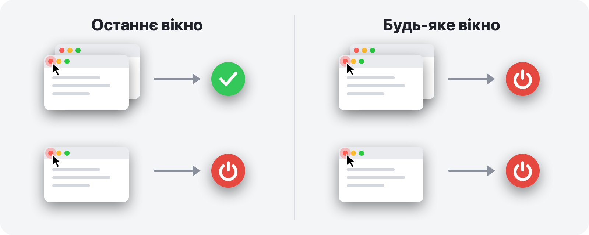

<p align="center">
  
</p>

<h1 align="center">RedQuit</h1>

<p align="center">
  <b>Закрили вікно — завершили програму.</b><br>
  Червона кнопка на вашому Mac працює так само, як у Windows.
</p>

<p align="center">
  <a href="https://github.com/Toys-D/RedQuit/releases/latest"></a>
  
  
  
  <a href="../LICENSE"></a>
</p>

<p align="center">
  <a href="https://github.com/Toys-D/RedQuit/releases/latest"><b>Завантажити RedQuit</b></a> · macOS 14 Sonoma або новіша · Apple Silicon та Intel · безкоштовно
</p>

<p align="center">
  <a href="../README.md">English</a> ·
  <a href="README.ru.md">Русский</a> ·
  <b>Українська</b> ·
  <a href="README.es.md">Español</a> ·
  <a href="README.pt-BR.md">Português</a> ·
  <a href="README.fr.md">Français</a> ·
  <a href="README.de.md">Deutsch</a> ·
  <a href="README.it.md">Italiano</a> ·
  <a href="README.pl.md">Polski</a> ·
  <a href="README.tr.md">Türkçe</a> ·
  <a href="README.ja.md">日本語</a> ·
  <a href="README.ko.md">한국어</a> ·
  <a href="README.zh-Hans.md">简体中文</a> ·
  <a href="README.zh-Hant.md">繁體中文</a> ·
  <a href="README.ar.md">العربية</a> ·
  <a href="README.hi.md">हिन्दी</a>
</p>


## Навіщо

На Mac червона кнопка лише закриває вікно. Програма продовжує працювати: залишається в Dock, займає пам’ять і чекає, поки ви завершите її через ⌘Q. Якщо ви перейшли з Windows або просто очікуєте, що червона кнопка означає «роботу з цією програмою закінчено», RedQuit для вас.

RedQuit розміщується на смузі меню й стежить лише за одним: клацанням червоної кнопки закриття. Якщо це клацання закриває останнє вікно програми, RedQuit завершує програму.

## Що він робить

- **Лише червона кнопка.** ⌘W і «Файл ▸ Закрити» працюють як раніше. RedQuit реагує лише на клацання мишею червоної кнопки.
- **Чекає, доки вікно справді закриється.** Якщо програма питає «Зберегти зміни?», а ви натискаєте «Скасувати», нічого не відбувається.
- **Завершує програму звичайним способом, як ⌘Q.** Програми, як і раніше, питають про незбережені документи. RedQuit ніколи нічого не завершує примусово.
- **Знає, де ваші вікна.** Згорнуті вікна, вікна на інших робочих столах і в повноекранному режимі вважаються відкритими.
- **Не чіпає Finder і систему.** Власні винятки можна додати одним клацанням.
- **Не заважає.** Жодного значка в Dock, лише маленький символ на смузі меню.
- **Розмовляє вашою мовою.** 16 мов відповідно до налаштувань вашого Mac.
- **Приватність.** RedQuit лише зчитує інформацію про вікна. Він ніколи нічого не клацає за вас, не блокує й не змінює ваші клацання, не підключається до мережі й нічого не збирає.

## Два режими



| | **Останнє вікно** (типово) | **Будь-яке вікно** |
|---|---|---|
| Червона кнопка на одному з кількох вікон | програма продовжує працювати | програма завершується |
| Червона кнопка на останньому вікні | програма завершується | програма завершується |
| Підходить для | щоденної роботи | програм, якими ви завжди користуєтеся в одному вікні |

Режим перемикається на смузі меню: RedQuit ▸ Режим.

## Знімки екрана

<picture>
  <source media="(prefers-color-scheme: dark)" srcset="../.github/screenshots/settings-dark.png">
  
</picture>

| | |
|:---:|:---:|
|  |  |
| **Меню:** пауза, режим, параметри | **Перший запуск:** потрібно ввімкнути лише один перемикач |

## Встановлення

1. Завантажте `RedQuit-1.0.0.dmg` зі [сторінки випусків](https://github.com/Toys-D/RedQuit/releases/latest) і перетягніть **RedQuit** у папку **Програми**.
2. Відкрийте RedQuit. Він не має платного сертифіката Apple, тому першого разу macOS відмовиться його відкривати. Перейдіть у **Системні параметри ▸ Приватність і безпека**, прокрутіть униз і клацніть **Усе одно відкрити**.
3. RedQuit попросить універсальний доступ. Клацніть **Відкрити Системні параметри** й увімкніть перемикач поруч із RedQuit у розділі **Приватність і безпека ▸ Універсальний доступ**. RedQuit одразу запрацює, перезапуск не потрібен.
4. За бажанням: у параметрах RedQuit увімкніть **Відкривати під час входу**.

**Оновлення.** Вийдіть із RedQuit через його меню й замініть програму в папці «Програми». macOS вважає кожну нову версію новою програмою, тому після оновлення перемикач універсального доступу перестає діяти: виберіть RedQuit у списку, вилучіть його кнопкою **−** і ввімкніть знову.

## Мови

English, Русский, Українська, Español, Português (Brasil), Français, Deutsch, Italiano, Polski, Türkçe, 日本語, 한국어, 简体中文, 繁體中文, العربية, हिन्दी.

RedQuit використовує мову вашого Mac. Щоб вибрати іншу мову лише для RedQuit, відкрийте **Системні параметри ▸ Загальні ▸ Мова й регіон ▸ Програми**. Переклади зроблено ретельно, але не всі — носіями мови: якщо щось звучить дивно, будь ласка, [створіть issue](https://github.com/Toys-D/RedQuit/issues).

## Як це працює

1. Глобальний монітор миші отримує копії ваших клацань. Він не може затримати, заблокувати чи змінити їх.
2. Після клацання RedQuit запитує в API універсального доступу macOS, що розташовано під курсором. Він діє, лише якщо це кнопка закриття вікна (`AXCloseButton`).
3. Якщо ви відпустили кнопку миші не над червоною кнопкою, закриття скасовано, і RedQuit нічого не робить.
4. RedQuit чекає, доки вікно справді зникне. Якщо програма показує «Зберегти зміни?», він чекає на вашу відповідь.
5. У режимі **Останнє вікно** він рахує решту вікон програми: звичайні й згорнуті — через універсальний доступ, а вікна на інших робочих столах і в повноекранному режимі — через віконний сервер.
6. Якщо вікон не лишилося (або в режимі **Будь-яке вікно**), RedQuit просить програму завершитися — точно так само, як ⌘Q.

Якщо RedQuit у чомусь не впевнений, він залишає програму працювати. Кожне рішення записується в системний журнал: відкрийте **Консоль** і введіть у пошуку `subsystem:com.toysforminds.RedQuit`.

## Збирання з вихідного коду

Потрібен Xcode 16 або новіший (Swift 6) на macOS 14 або новішій.

```bash
./Scripts/build.sh     # builds build/RedQuit.app
swift test             # unit tests
./Scripts/release.sh   # universal build and dist/RedQuit-<version>.dmg
```

`build.sh` підписує програму вашим сертифікатом Apple Development, якщо він у вас є, тож дозвіл універсального доступу зберігається після перезбирання. Якщо сертифіката немає, запустіть `ADHOC=1 ./Scripts/build.sh`.

Ліцензія дозволяє збирати RedQuit для власного користування, але не змінювати його й не поширювати змінені збірки.

## Підтримати проєкт

RedQuit безкоштовний. Якщо він щодня заощаджує вам кілька клацань і ви хочете подякувати, ви можете підтримати його розробку.

**[Підтримати через PayPal](https://www.paypal.com/cgi-bin/webscr?cmd=_xclick&business=pixmap1981%40gmail.com&item_name=RedQuit&currency_code=USD)** · Підтримка добровільна, від неї ніщо в програмі не залежить.

## Зв’язок

Помилки, запитання, ідеї: **[pixmap1981@gmail.com](mailto:pixmap1981@gmail.com?subject=RedQuit)** або створіть [issue](https://github.com/Toys-D/RedQuit/issues).

## Ліцензія

RedQuit — безкоштовна програма (freeware). Ви можете користуватися нею безоплатно вдома чи на роботі й поширювати незмінені копії. Ви не можете змінювати її, публікувати змінені версії чи продавати її. Повні умови наведено у файлі [LICENSE](../LICENSE). Юридичну силу має англійський текст LICENSE, а цей короткий виклад наведено для зручності.

---

<p align="center">
  <br>
  <sub>Створено Toys for Minds</sub>
</p>
