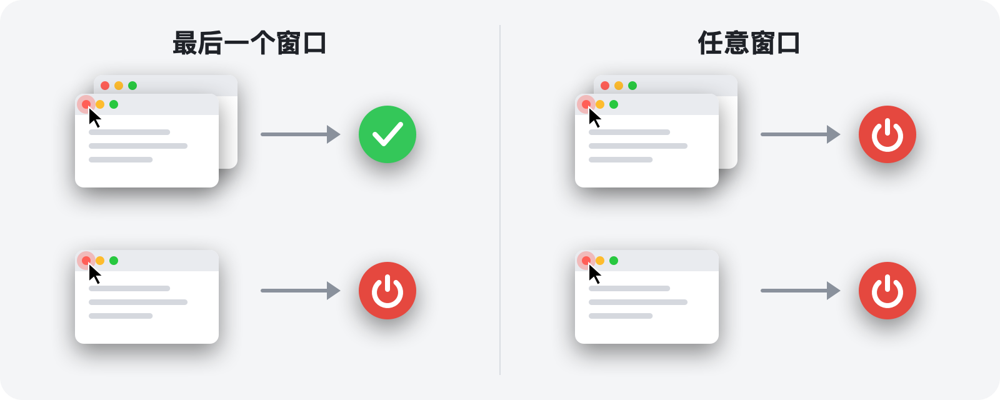

<p align="center">
  
</p>

<h1 align="center">RedQuit</h1>

<p align="center">
  <b>关闭窗口，就退出 App。</b><br>
  让 Mac 上的红色按钮像在 Windows 上一样工作。
</p>

<p align="center">
  <a href="https://github.com/Toys-D/RedQuit/releases/latest"></a>
  
  
  
  <a href="../LICENSE"></a>
</p>

<p align="center">
  <a href="https://github.com/Toys-D/RedQuit/releases/latest"><b>下载 RedQuit</b></a> · macOS 14 Sonoma 或更高版本 · Apple 芯片和 Intel · 免费
</p>

<p align="center">
  <a href="../README.md">English</a> ·
  <a href="README.ru.md">Русский</a> ·
  <a href="README.uk.md">Українська</a> ·
  <a href="README.es.md">Español</a> ·
  <a href="README.pt-BR.md">Português</a> ·
  <a href="README.fr.md">Français</a> ·
  <a href="README.de.md">Deutsch</a> ·
  <a href="README.it.md">Italiano</a> ·
  <a href="README.pl.md">Polski</a> ·
  <a href="README.tr.md">Türkçe</a> ·
  <a href="README.ja.md">日本語</a> ·
  <a href="README.ko.md">한국어</a> ·
  <b>简体中文</b> ·
  <a href="README.zh-Hant.md">繁體中文</a> ·
  <a href="README.ar.md">العربية</a> ·
  <a href="README.hi.md">हिन्दी</a>
</p>


## 为什么需要 RedQuit

在 Mac 上，红色按钮只会关闭窗口。App 仍在运行：它留在程序坞中，继续占用内存，一直等到你用 ⌘Q 将其退出。如果你是从 Windows 转过来的，或者只是希望红色按钮表示“这个 App 我用完了”，那么 RedQuit 正适合你。

RedQuit 待在菜单栏中，只留意一件事：点按红色关闭按钮。当这次点按关闭了 App 的最后一个窗口时，RedQuit 就会退出该 App。

## 功能

- **只响应红色按钮**：⌘W 和“文件 ▸ 关闭”照常工作。RedQuit 只对用鼠标点按红色按钮作出反应。
- **等待窗口真正关闭**：如果 App 询问“要存储更改吗？”而你点按了“取消”，则什么也不会发生。
- **像 ⌘Q 一样正常退出**：App 仍会就未存储的文稿进行询问。RedQuit 从不强制退出任何 App。
- **知道你的窗口在哪里**：最小化的窗口、其他桌面上的窗口和全屏幕窗口都算作打开的窗口。
- **不干预访达和系统**：点按一下即可添加你自己的例外。
- **不打扰你**：没有程序坞图标，只在菜单栏中显示一个小图标。
- **说你的语言**：支持 16 种语言，跟随 Mac 的设置。
- **注重隐私**：RedQuit 只读取窗口相关信息。它从不替你点按任何内容，从不拦截或更改你的点按，不建立任何网络连接，也不收集任何数据。

## 两种模式



| | **最后一个窗口**（默认） | **任意窗口** |
|---|---|---|
| 在多个窗口之一上点按红色按钮 | App 继续运行 | App 退出 |
| 在最后一个窗口上点按红色按钮 | App 退出 | App 退出 |
| 适用于 | 日常使用 | 始终只用一个窗口的 App |

在菜单栏中切换模式：RedQuit ▸ 模式。

## 截图

<picture>
  <source media="(prefers-color-scheme: dark)" srcset="../.github/screenshots/settings-dark.png">
  
</picture>

| | |
|:---:|:---:|
|  |  |
| **菜单**：暂停、模式、设置 | **首次启动**：只需打开一个开关 |

## 安装

1. 从[发布页面](https://github.com/Toys-D/RedQuit/releases/latest)下载 `RedQuit-1.0.0.dmg`，然后将 **RedQuit** 拖到**应用程序**文件夹中。
2. 打开 RedQuit。由于它没有付费的 Apple 证书，第一次打开时 macOS 会拒绝打开它。前往**系统设置 ▸ 隐私与安全性**，向下滚动并点按**仍要打开**。
3. RedQuit 会请求辅助功能权限。点按**打开系统设置**，然后在**隐私与安全性 ▸ 辅助功能**中打开 RedQuit 旁边的开关。RedQuit 会立即开始工作，无需重新启动。
4. 可选：在 RedQuit 的设置中打开**登录时打开**。

**更新**：从菜单中退出 RedQuit，然后替换“应用程序”文件夹中的 App。macOS 会将每个新版本视为一个新的 App，因此更新后辅助功能开关会失效：在列表中选择 RedQuit，使用 **−** 按钮将其移除，然后重新打开开关。

## 语言

English, Русский, Українська, Español, Português (Brasil), Français, Deutsch, Italiano, Polski, Türkçe, 日本語, 한국어, 简体中文, 繁體中文, العربية, हिन्दी.

RedQuit 跟随 Mac 的语言。若只想为 RedQuit 选择其他语言，请前往**系统设置 ▸ 通用 ▸ 语言与地区 ▸ 应用程序**。翻译经过用心打磨，但并非全部出自母语者之手：如果有读起来别扭的地方，请[提交 Issue](https://github.com/Toys-D/RedQuit/issues)。

## 工作原理

1. 全局鼠标监视器会接收你点按操作的副本。它无法延迟、拦截或更改这些点按。
2. 每次点按时，RedQuit 会通过 macOS 的辅助功能 API 查询指针下方是什么。只有当它是窗口的关闭按钮（`AXCloseButton`）时，RedQuit 才会采取行动。
3. 如果你在离开红色按钮的位置松开鼠标按钮，说明关闭已被取消，RedQuit 不会执行任何操作。
4. RedQuit 会等待窗口真正消失。如果 App 显示“要存储更改吗？”，它会等待你的回答。
5. 在**最后一个窗口**模式下，它会统计 App 剩余的窗口：通过辅助功能统计普通窗口和最小化的窗口，通过窗口服务器统计其他桌面上的窗口和全屏幕窗口。
6. 如果没有剩余窗口（或处于**任意窗口**模式），RedQuit 会请求 App 退出，与 ⌘Q 完全相同。

只要 RedQuit 不确定，就会让 App 继续运行。每个决定都会写入系统日志：打开**控制台**并搜索 `subsystem:com.toysforminds.RedQuit`。

## 从源代码构建

需要 macOS 14 或更高版本，以及 Xcode 16 或更高版本（Swift 6）。

```bash
./Scripts/build.sh     # builds build/RedQuit.app
swift test             # unit tests
./Scripts/release.sh   # universal build and dist/RedQuit-<version>.dmg
```

如果你有 Apple Development 证书，`build.sh` 会用它为 App 签名，这样重新构建后辅助功能权限依然有效。如果没有证书，请运行 `ADHOC=1 ./Scripts/build.sh`。

许可允许你构建 RedQuit 供自己使用，但不允许修改它，也不允许分享修改后的构建版本。

## 支持本项目

RedQuit 是免费的。如果它每天为你省下几次点按，而你想表达感谢，可以支持它的开发。

**[通过 PayPal 支持](https://www.paypal.com/cgi-bin/webscr?cmd=_xclick&business=pixmap1981%40gmail.com&item_name=RedQuit&currency_code=USD)** · 支持完全自愿；App 的任何功能都不取决于此。

## 联系方式

如有 Bug、问题或想法，请发送邮件至 **[pixmap1981@gmail.com](mailto:pixmap1981@gmail.com?subject=RedQuit)**，或提交 [Issue](https://github.com/Toys-D/RedQuit/issues)。

## 许可

RedQuit 是免费软件。你可以在家中或工作中免费使用它，并分享未经修改的副本。你不得修改它、发布修改后的版本或出售它。完整条款请参阅 [LICENSE](../LICENSE)。本摘要仅为方便阅读而提供，具有约束力的是英文版 LICENSE。

---

<p align="center">
  <br>
  <sub>由 Toys for Minds 制作</sub>
</p>
