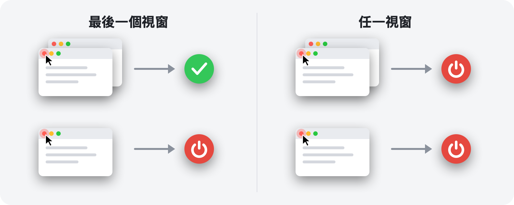

<p align="center">
  
</p>

<h1 align="center">RedQuit</h1>

<p align="center">
  <b>關閉視窗，就結束 App。</b><br>
  讓 Mac 上的紅色按鈕像在 Windows 上一樣運作。
</p>

<p align="center">
  <a href="https://github.com/Toys-D/RedQuit/releases/latest"></a>
  
  
  
  <a href="../LICENSE"></a>
</p>

<p align="center">
  <a href="https://github.com/Toys-D/RedQuit/releases/latest"><b>下載 RedQuit</b></a> · macOS 14 Sonoma 或以上版本 · Apple 晶片和 Intel · 免費
</p>

<p align="center">
  <a href="../README.md">English</a> ·
  <a href="README.ru.md">Русский</a> ·
  <a href="README.uk.md">Українська</a> ·
  <a href="README.es.md">Español</a> ·
  <a href="README.pt-BR.md">Português</a> ·
  <a href="README.fr.md">Français</a> ·
  <a href="README.de.md">Deutsch</a> ·
  <a href="README.it.md">Italiano</a> ·
  <a href="README.pl.md">Polski</a> ·
  <a href="README.tr.md">Türkçe</a> ·
  <a href="README.ja.md">日本語</a> ·
  <a href="README.ko.md">한국어</a> ·
  <a href="README.zh-Hans.md">简体中文</a> ·
  <b>繁體中文</b> ·
  <a href="README.ar.md">العربية</a> ·
  <a href="README.hi.md">हिन्दी</a>
</p>


## 為什麼需要 RedQuit

在 Mac 上，紅色按鈕只會關閉視窗。App 會繼續執行：它留在 Dock 裡、持續佔用記憶體，一直等到你用 ⌘Q 結束它。如果你是從 Windows 轉過來的，或者只是希望紅色按鈕代表「這個 App 我用完了」，那 RedQuit 正適合你。

RedQuit 待在選單列中，只留意一件事：按一下紅色關閉按鈕。當這一下關閉了 App 的最後一個視窗時，RedQuit 就會結束該 App。

## 功能

- **只對紅色按鈕起作用**：⌘W 和「檔案 ▸ 關閉」照常運作。RedQuit 只會對用滑鼠按一下紅色按鈕做出反應。
- **等到視窗真正關閉**：如果 App 詢問「要儲存變更嗎？」而你按下「取消」，就什麼也不會發生。
- **用一般的方式結束，就像 ⌘Q**：App 仍會詢問未儲存的文件。RedQuit 絕不會強制結束任何 App。
- **知道你的視窗在哪裡**：縮到最小的視窗、其他桌面上的視窗和全螢幕視窗，都會算作開啟中的視窗。
- **不干涉 Finder 和系統**：按一下就能加入你自己的例外項目。
- **不打擾你**：沒有 Dock 圖像，只在選單列中顯示一個小符號。
- **說你的語言**：支援 16 種語言，跟隨 Mac 的設定。
- **注重隱私**：RedQuit 只會讀取視窗的相關資訊。它絕不會替你按任何東西，絕不會阻擋或更改你的點按，不會建立任何網路連線，也不會收集任何資料。

## 兩種模式



| | **最後一個視窗**（預設） | **任一視窗** |
|---|---|---|
| 在多個視窗之一按下紅色按鈕 | App 繼續執行 | App 結束 |
| 在最後一個視窗按下紅色按鈕 | App 結束 | App 結束 |
| 適合 | 日常使用 | 總是只用一個視窗的 App |

在選單列切換模式：RedQuit ▸ 模式。

## 螢幕截圖

<picture>
  <source media="(prefers-color-scheme: dark)" srcset="../.github/screenshots/settings-dark.png">
  
</picture>

| | |
|:---:|:---:|
|  |  |
| **選單**：暫停、模式、設定 | **首次啟動**：只需開啟一個開關 |

## 安裝

1. 從[發行頁面](https://github.com/Toys-D/RedQuit/releases/latest)下載 `RedQuit-1.0.0.dmg`，然後將 **RedQuit** 拖移到**應用程式**檔案夾。
2. 打開 RedQuit。由於它沒有付費的 Apple 憑證，第一次打開時 macOS 會拒絕打開它。前往**系統設定 ▸ 隱私權與安全性**，向下捲動並按一下**強制打開**。
3. RedQuit 會要求「輔助使用」權限。按一下**打開系統設定**，然後在**隱私權與安全性 ▸ 輔助使用**中開啟 RedQuit 旁的開關。RedQuit 會立即開始運作，不需要重新啟動。
4. 選用：在 RedQuit 的設定中開啟**登入時打開**。

**更新**：從選單結束 RedQuit，然後替換「應用程式」檔案夾中的 App。macOS 會把每個新版本都視為新的 App，因此更新後「輔助使用」開關會失效：在列表中選取 RedQuit，用 **−** 按鈕將其移除，然後再重新開啟。

## 語言

English, Русский, Українська, Español, Português (Brasil), Français, Deutsch, Italiano, Polski, Türkçe, 日本語, 한국어, 简体中文, 繁體中文, العربية, हिन्दी.

RedQuit 會跟隨 Mac 的語言。若只想為 RedQuit 選擇其他語言，請前往**系統設定 ▸ 一般 ▸ 語言與地區 ▸ 應用程式**。翻譯都經過用心製作，但並非全部出自母語人士之手：如果有讀起來不太自然的地方，請[提出 Issue](https://github.com/Toys-D/RedQuit/issues)。

## 運作方式

1. 全域滑鼠監視器會接收你點按的副本。它無法延遲、阻擋或更改這些點按。
2. 每次點按時，RedQuit 會透過 macOS 的輔助使用 API 查詢指標下方是什麼。只有當它是視窗的關閉按鈕（`AXCloseButton`）時，RedQuit 才會採取動作。
3. 如果你在離開紅色按鈕的位置放開滑鼠按鈕，就代表取消了關閉，RedQuit 不會執行任何動作。
4. RedQuit 會等到視窗真正消失。如果 App 顯示「要儲存變更嗎？」，它會等待你的回應。
5. 在**最後一個視窗**模式中，它會計算 App 剩下的視窗：一般視窗和縮到最小的視窗透過輔助使用計算，其他桌面上的視窗和全螢幕視窗則透過視窗伺服器計算。
6. 如果沒有剩下任何視窗（或在**任一視窗**模式中），RedQuit 會要求 App 結束，與 ⌘Q 完全相同。

只要 RedQuit 不確定，就會讓 App 繼續執行。每個決定都會寫入系統記錄：打開**主控台**並搜尋 `subsystem:com.toysforminds.RedQuit`。

## 從原始碼建置

需要 macOS 14 或以上版本，以及 Xcode 15 或以上版本（Swift 6）。

```bash
./Scripts/build.sh     # builds build/RedQuit.app
swift test             # unit tests
./Scripts/release.sh   # universal build and dist/RedQuit-<version>.dmg
```

如果你有 Apple Development 憑證，`build.sh` 會用它為 App 簽署，因此重新建置後「輔助使用」權限仍會保留。如果沒有憑證，請執行 `ADHOC=1 ./Scripts/build.sh`。

授權允許你建置 RedQuit 供自己使用，但不允許修改它，也不允許分享修改過的建置版本。

## 支持本專案

RedQuit 是免費的。如果它每天幫你省下幾次點按，而你想表達謝意，可以支持它的開發。

**[透過 PayPal 支持](https://www.paypal.com/cgi-bin/webscr?cmd=_xclick&business=pixmap1981%40gmail.com&item_name=RedQuit&currency_code=USD)** · 支持完全出於自願；App 中沒有任何功能取決於此。

## 聯絡方式

如有錯誤回報、問題或想法，請寄信至 **[pixmap1981@gmail.com](mailto:pixmap1981@gmail.com?subject=RedQuit)**，或提出 [Issue](https://github.com/Toys-D/RedQuit/issues)。

## 授權

RedQuit 是免費軟體。你可以在家中或工作場所免費使用它，並分享未經修改的副本。你不得修改它、發佈修改過的版本或販售它。完整條款請見 [LICENSE](../LICENSE)。本摘要僅為方便閱讀而提供，具約束力的是英文版 LICENSE。

---

<p align="center">
  <br>
  <sub>由 Toys for Minds 製作</sub>
</p>
